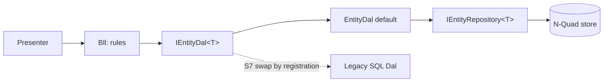

# Stage review: S2 the Dal layer (2026-10-31)

Branch `refactor-s2-dal` in `Adventures.Foundation` (app repo: `Program.cs` wiring and this document). Third stage of the decoupling refactor ([reference](../Claude-architecture-reference.md), section 7).

## What was built

1. **`IEntityDal<TEntity>`** (`Adventures.Entities/Core`): the data-access layer a Bll talks to. Same CRUDL surface and semantics as the repository (delete tombstones, update supersedes).
2. **`EntityDal<TEntity>`**: the default Dal. It is the only class in `Adventures.Entities` that names a repository; it uses an `IEntityRepository<TEntity>` as its storage tool. A repository no longer stands in for a Dal.
3. **Every Bll depends on the Dal**: `EntityBll<T>` (the `Repository` member is now `Dal`), `UserBll`, `PostBll`, `PageBll`, `CollaborationBll`, `ExceptionLogBll`, `ExceptionSignatureBll`, `SchemaBll` and `RoleRightsUpgrade` take `IEntityDal<T>`.
4. **Registration**: `AddNQuadEntityRepository<T>` also registers `IEntityDal<T>` with `TryAdd`, so a host that registers its own Dal for a type first wins. This is the seam S7 uses (`Mode=Legacy|New` swaps Dals by registration only). The app's `Program.cs` hand-registered Blls now resolve the Dal.
5. **Guard test** (11 now): no file in `Adventures.Entities` other than `EntityDal.cs` and the repository contract names `IEntityRepository<`.

## Verified

- Red: the new guard failed naming the nine files that still referenced a repository; green after the switch.
- Foundation: all suites pass (Architecture 11, Data 24, Security 58, Identity 33, Ioc 5, Common 30, Entities 212, Data.NQuad 81, WebApi 91).
- App: solution builds; WebApi 126, McpServer 83 and LegacyImport 16 pass.

## Not verified / limits

- The app host was not started (the Run line is the check); a Bll whose entity type has no `AddNQuadEntityRepository` call would fail to resolve at first use.
- The Dal is still generic over `DynamicEntity` (decision D1). It is a seam, not new behaviour: `EntityDal<T>` only delegates. A Dal that shapes data differently arrives with S7.
- `tools/LegacyImport` still uses repositories directly (an importer, not a Bll); it moves to the Dal with S7.
- `PostgresEntityRepository` (the Data side) keeps its name; it is not a Dal and leaves with the Data split in S5.
- Angular suite not run (no client change).

## Decisions

None open. Next: S3 (extract `Adventures.Blog`) on `refactor-s3-blog`, the largest stage.
