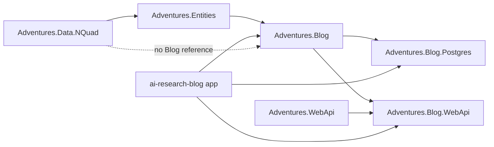

# Stage review: S3 extract the Blog (2026-10-31)

Branch `refactor-s3-blog` in `Adventures.Foundation` and `ai-research-blog`. Fourth stage of the decoupling refactor ([reference](../Claude-architecture-reference.md), section 7). The largest stage so far; no behaviour change intended.

## What was built

1. **`Adventures.Blog`** (new project, references only `Adventures.Entities`): Posts, Pages, Taxonomy (Category, Tag), Media, Settings (SiteSetting), Slugs, Content (public content, authoring), Migration, and `BlogConstants`. Namespace `Adventures.Blog`. `Adventures.Entities` no longer contains any blog type.
2. **`AddBlog()`** (`Adventures.Blog/DependencyInjection`): one call wires the blog Blls, presenters and services. It is store-agnostic; the host still registers where each blog entity is stored (the Dal choice, S7).
3. **`Adventures.Blog.Postgres`** (new): `NpgsqlMediaStore` (uploaded images in a table), moved out of `Adventures.Data.NQuad`, so Data.NQuad no longer needs the Blog and the Blog needs no Npgsql.
4. **`Adventures.Blog.WebApi`** (new, decision D2): the blog controllers (posts, pages, categories, tags, media, site settings, public read side, authoring) moved out of the app, plus `AddBlogControllers()` so a host makes MVC find them. The app's own controllers (users, roles, collaboration, health, ...) stay.
5. **Cut-line fixes** found by the compiler, each a dependency Collaboration had on the Blog:
   - the conversation no longer knows posts: `IConversationTarget` (Entities) with `PostConversationTarget` (Blog) and `CollaborationConversationTarget` (Entities);
   - `PostApproval` (review states) now lives with Collaboration;
   - the comment constants moved to `CollaborationConstants`; `BlogConstants` holds the rest of the old `EntityConstants.Content` and `.Site`;
   - the `Blog` entity (a tenant-owned site) stays in `Adventures.Entities/Security`; `CollaborationMigration` moved to the Blog project (it reads posts) until S4.
6. **Tests**: the blog and migration tests moved to the new `Adventures.Blog.Tests` (62); `Adventures.Entities.Tests` keeps 150. A new app test proves each blog controller is discovered exactly once.
7. **Guards** (13 now): the project graph, Blog references only Entities, Blog.Postgres only Blog, Blog.WebApi only Blog/Security/WebApi, and only the Blog stack may reference the Blog. The app's route-rights guards now scan both controller assemblies, so moving controllers did not weaken them.

A new app (the NQuad browser, S8) can now reference `Adventures.Entities` and `Adventures.Data.NQuad` without any blog code.

## Verified

- Foundation: all suites pass (Architecture 13, Blog 62, Entities 150, Data.NQuad 81, WebApi 91, Security 58, Identity 33, Common 30, Data 24, Ioc 5). A deliberate Security-to-Blog reference failed the graph guard.
- App: solution builds; WebApi 127, McpServer 83, LegacyImport 16 pass.

## Not verified / limits

- The app was not started with real configuration (the local run reports "configuration incomplete" without secrets). The live path (public posts, site settings, media, admin lists) is checked by your Run line, and by `Claude-verify.ps1` after any deploy.
- The Foundation `WebApi` project still references `Data.NQuad`, so `Blog.WebApi` reaches the N-Quad store transitively until S5.
- The three moved-controller tests (public, media, authoring) still live in the app test project; they move to a Blog.WebApi test project later. `CollaborationTests` sits in `Adventures.Blog.Tests` because it covers the migration; S4 splits it.
- Seeds stay in `Adventures.Data.NQuad/Sql/seed` until the Data split (S5).
- Angular suite not run (no client change).

## Decisions

None open. Next: S4 (Collaboration and the plug-in seam) on `refactor-s4-collab`.
