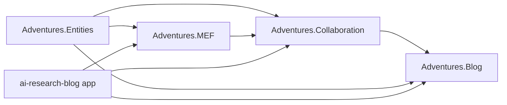

# Stage review: S4 extract Collaboration and the plug-in seam (2026-10-31)

Branch `refactor-s4-collab` in `Adventures.Foundation` and `ai-research-blog`. Fifth stage of the decoupling refactor ([reference](../Claude-architecture-reference.md), section 7). No behaviour change intended.

## What was built

1. **`Adventures.MEF`** (new, references only `Adventures.Entities`): the plug-in seam. `Plugin`, `PluginDefinition`, `PluginState`, `IPlugins` and `Plugins` moved here. The built-in catalog is gone: features declare their plug-ins and the seam reads whatever is registered (`AddPlugins()`, `AddPlugin(definition)`). The stored state, the Plugins page and the switch behaviour are unchanged.
2. **`Adventures.Collaboration`** (new, references Entities and MEF): collaboration items (Developer and Research kinds), the shared conversation (`Comment`, `IConversation`, targets), `PostApproval`, the authoring surface, and `CollaborationPlugins` (the three definitions; was `PluginCatalog`). `AddCollaboration()` wires the feature and registers its plug-ins.
3. **`Adventures.Blog` now builds on Collaboration** (its conversation target, comment authoring and the migration use it). Collaboration knows no blog type. `Adventures.Entities` holds neither feature.
4. **App wiring**: `Program.cs` calls `AddBlog()` then `AddCollaboration()` (that order keeps the post target first, as before) and keeps only where each entity is stored.
5. **Tests**: plug-in tests moved to the new `Adventures.Collaboration.Tests`; Entities 147, Blog 62, Collaboration 3. **Guards** (14): Collaboration references only Entities and MEF, MEF only Entities, and only the Blog builds on Collaboration.

## Verified

- Foundation: all suites pass (Architecture 14, Blog 62, Collaboration 3, Entities 147, Data.NQuad 81, WebApi 91, Security 58, Identity 33, Common 30, Data 24, Ioc 5).
- App: solution builds; WebApi 127 (including the menu-by-plug-in tests), McpServer 83, LegacyImport 16; the LegacyImport tool builds.

## Not verified / limits

- The app was not started with real configuration; the Run line is the check (Plugins page, switching a plug-in off, a collaboration item, a post conversation).
- The collaboration, conversation, plug-in and menu controllers stay in the app for now (they also carry the `RequiresPlugin` filter). They move to a `Collaboration.WebApi` library when a second host needs them (the NQuad browser needs none of them).
- Loading plug-ins from outside the app (the "MEF" of the name) is still a later step; this stage only makes the seam a library other features can register into.
- Angular suite not run (no client change).

## Decisions

None open. Next: S5 (split `Adventures.Data`; also removes the remaining store references from Identity and WebApi) on `refactor-s5-data`.
