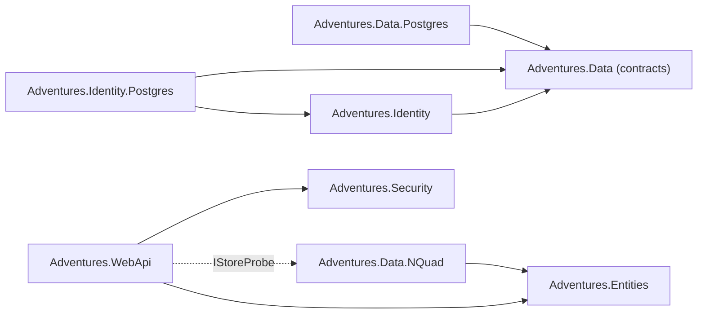

# Stage review: S5 split the Data layer (2026-10-31)

Branch `refactor-s5-data` in `Adventures.Foundation` and `ai-research-blog` (plus a one-line path fix in the workspace root script). Sixth stage of the decoupling refactor ([reference](../Claude-architecture-reference.md), section 7). No behaviour change intended.

## What was built

1. **`Adventures.Data` is contracts only** (no package, no project reference): the entity record, the triple, `IEntityRecordRepository`, `ISqlExecutor`, `ITripleStore`.
2. **`Adventures.Data.Postgres`** (new, references Data): `NpgsqlSqlExecutor`, `PostgresEntityRepository`, `PostgresTripleStore` and the SQL schema scripts, with Npgsql and Dapper. Their tests moved with them: `Adventures.Data.Tests` is now `Adventures.Data.Postgres.Tests`.
3. **`Adventures.Identity.Postgres`** (new): the PostgreSQL credential vault moved out of `Adventures.Identity`, wired by `AddPostgresUserCredentials()`. Identity now names no database; `AddUserIdentity()` expects the host to register a credential store.
4. **`Adventures.WebApi` no longer references a store**: the health probe asks an `IStoreProbe` (`Adventures.Common.Diagnostics`); the N-Quad store supplies `NQuadStoreProbe`, registered with its entity repository. A future SQL store supplies its own probe, nothing in the probes changes.
5. **Guard tests** (15): the three ratchets that listed S5 violations are now empty (Identity, WebApi and the Postgres stores are clean), `Adventures.Data` must carry no driver and no reference, and the project graph is pinned again. Blog.WebApi no longer reaches the N-Quad store.
6. **App**: `Program.cs` registers `AddPostgresUserCredentials()` and uses the Postgres namespace; the local DB init script follows the moved SQL.

## Decisions made on the way (shout if you disagree)

- Rule 3 ("a store builds on Adventures.Data") was wrong for the N-Quad store: it implements the contracts that live in Entities (`IEntityRepository<T>`, `IEntityDal<T>`) and needs nothing from Data. The rule now applies to the Postgres stores only.
- `Adventures.Data` keeps the name and namespace: it is the contract project the Postgres stores and Identity share. The N-Quad schema code stays inside `Adventures.Data.NQuad` for now (splitting it out is only worth it when a second schema consumer appears).

## Verified

- Foundation: all suites pass (Architecture 15, Blog 62, Collaboration 3, Entities 147, Data.NQuad 81, Data.Postgres 24, WebApi 91, Security 58, Identity 33, Common 30, Ioc 5). The old ratchets failed first, proving the violations were gone.
- App: solution builds; WebApi 127, McpServer 83, LegacyImport 16 pass; the LegacyImport tool builds.

## Not verified / limits

- The app was not started with real configuration; the Run line is the check (sign in exercises the credential store and the entity record repository; Health exercises the store probe).
- `Adventures.Security` still carries the ASP.NET JwtBearer package (S6).
- NuGet publishing was not touched: `publish.yml` packs Security, Data and Identity only, and Data is now contracts. Packaging stays decision D5 (after S9).
- Angular suite not run (no client change).

## Decisions

None open. Next: S6 (Security without ASP.NET) on `refactor-s6-security`.
