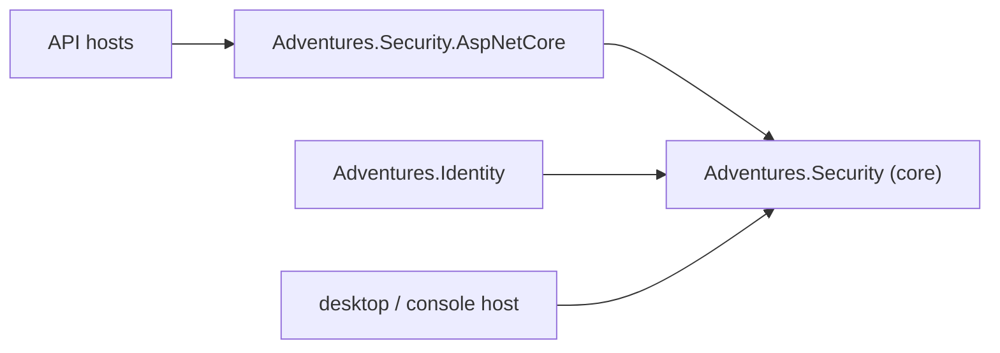

# Stage review: S6 Security without ASP.NET (2026-10-31)

Branch `refactor-s6-security` in `Adventures.Foundation` and `ai-research-blog`. Seventh stage of the decoupling refactor ([reference](../Claude-architecture-reference.md), section 7). No behaviour change intended; this removes the last recorded architecture violation.

## What was built

1. **`Adventures.Security` is the framework-free core**: token issuing and validation settings, M2M client credentials, the PBKDF2 password and client-secret hashers, well-known claims. No web framework reference and no project reference; the ASP.NET JwtBearer package is gone from it.
2. **`Adventures.Security.AspNetCore`** (new): the JWT bearer authentication wiring (`AddSharedJwtAuthentication`), the scope and role authorization policies and handlers. Namespaces stayed `Adventures.Security`, so no C# consumer changed; the two app APIs and their tests gained the project reference.
3. **`ICurrentPrincipal`** (core) with `AmbientPrincipal` (a settable holder for a desktop, console or test host) and `HttpContextPrincipal` (the request user, `AddCurrentPrincipal()`): who is acting is a `ClaimsPrincipal`, never an HTTP context. Nothing consumes it yet; it is the seam S9 (the WPF app with a desktop sign-in) needs.
4. **Tests**: the web-framework tests moved to the new `Adventures.Security.AspNetCore.Tests` (18); `Adventures.Security.Tests` (43) now references only the core, which is the proof that a console-style project can use Security alone.
5. **Guards** (16): the last ratchet entry is gone (Security has no ASP.NET package), and a new guard fails if the core gains a framework or project reference or if its tests reference anything but the core.

## Verified

- Foundation: all suites pass (Architecture 16, Security 43, Security.AspNetCore 18, Blog 62, Collaboration 3, Entities 147, Data.NQuad 81, Data.Postgres 24, WebApi 91, Identity 33, Common 30, Ioc 5).
- App: solution and LocalTriage build; WebApi 127, McpServer 83, LegacyImport 16 pass.

## Not verified / limits

- The app was not started with real configuration; the Run line is the check (sign in, and an M2M call such as Health's mcp probe, both exercise the token wiring).
- `ICurrentPrincipal` has no consumer yet (see item 3).
- The packages `Adventures.Security` (core) and `Adventures.Security.AspNetCore` are not published; packaging stays decision D5.
- Angular suite not run (no client change).

## Decisions

None open. Next: S7 (`Adventures.Data.Sql` and `Mode=Legacy|New`) on `refactor-s7-sql-legacy`. It needs your input first: the legacy database access for reading (see the item).
