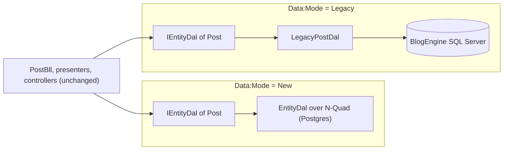

# Stage review: S7 Mode=Legacy over the BlogEngine SQL tables (2026-10-31)

Branch `refactor-s7-sql-legacy` in `Adventures.Foundation` and `ai-research-blog`. Eighth stage of the decoupling refactor ([reference](../Claude-architecture-reference.md), section 7). New mode, no change to the existing one (`Data:Mode` defaults to New).

## What was built

1. **`Data:Mode = New | Legacy`** (`DataMode` in the contracts project; anything else stops the start). The host changes registrations only: no Bll, presenter or controller knows the mode.
2. **`Adventures.Data.Sql`** (new, references Data and Common): a SQL Server `ISqlExecutor` (bound parameters only, a new pooled connection per call) and its health probe. Microsoft.Data.SqlClient pulls a Pkcs package with two known advisories, so the patched version is pinned.
3. **`Adventures.Blog.Legacy`** (new, references Blog and Data.Sql): `IEntityDal` for posts, pages, categories and tags over `be_Posts`, `be_Pages`, `be_Categories`, `be_PostCategory`, `be_PostTag`, with the blog resolved from `be_Blogs` (or `Legacy:BlogId`). `IsDeleted` is the tombstone for posts and pages; categories are deleted for real; a tag is a string on `be_PostTag`, so its id is derived from its name (same derivation as the importer). `AddBlogLegacy(connectionString)` is the whole switch: registered before the entity repositories (which only add a Dal where none exists), then `AddBlog()` as always.
4. **Pointer fields in Legacy**: `IRelationNameSource` (Entities) lets the relation provider take the names and choices of a schema from a source other than the N-Quad store; the legacy category and tag Dals are the sources.
5. **Collaboration is off in Legacy**: the host switches its three plug-ins off at start (the Plugins page shows them off); the legacy tables have no place for items.
6. **Developer sign-in (your caveat)**: `DevLoginAccountService` accepts Admin with the password Password, only when four gates all hold: the host registered it (Legacy mode only), `Legacy:DevLogin=true` (user-secrets or the Development settings file, never a deployed setting), the host environment is Development, and the request comes from this machine (`IRequestOrigin`: loopback address, and no `X-Forwarded-For`, `Forwarded` or `X-Real-IP` header). Any failed gate answers like a wrong password. No other account or password works. Each gate has a failing-if-removed test; the app has a guard that `AddDevLogin` appears once, inside the Legacy branch, and that the password literal appears nowhere in the app source.
7. **Guards** (17) pin the new references; **tests**: Blog.Legacy 18 (plus 1 live check that skips unless `LEGACY_SQL_CONNECTION` is set), Identity 43, WebApi 100.

## Verified

- Foundation: all suites pass (Architecture 17, Blog.Legacy 18, Identity 43, WebApi 100, Blog 62, Entities 147, Data.NQuad 81, Data.Postgres 24, Security 43 and 18, Collaboration 3, Common 30, Ioc 5). A first run caught that `Enum.TryParse` accepted the text "1" as Legacy; the parser is now names-only and has a test.
- App: solution builds; WebApi 129, McpServer 83, LegacyImport 16 pass.
- A real start in Legacy mode (SQL deliberately unreachable): the host starts; Admin with Password signs in on localhost (200); a wrong password (401), the same call with an `X-Forwarded-For` header (401), and the switch off (401) are refused; the Plugins endpoint reports the collaboration plug-ins off.

## Not verified / limits (please read)

- **No SQL Server was available to me**, so the SQL statements are verified only against a scripted executor (the right statements and bound parameters) and not against a real BlogEngine database. The live check is test step 2 of the item: it needs your database. The column assumptions come from the mirror schemas (seed 009).
- Not verified in a real Production start (that start needs more configuration than the smoke test had); the Production gate is covered by its unit test.
- Writes are several statements without a transaction (the executor has none): a failure between a post row and its category links leaves the post saved with its old links.
- A tag exists only on posts; a new tag lives in memory until a post uses it. A revision is refused in Legacy. Author is stored as the text the form sends (a user id for new posts; legacy names for old ones).
- Users, roles, tenants, plug-in states and site settings stay in the in-memory N-Quad store in Legacy (reset at each start); uploaded images use the in-memory media store; the legacy `be_Users` table is not read and legacy passwords are out of scope.
- LocalDB on this ARM machine cannot be loaded by the LocalDB client library; a named-pipe connection string should work (SqlClient is managed) but I could not try it.
- Angular suite not run (no client change).

## Decisions

1. The setting names `Data:Mode`, `Legacy:BlogId`, `Legacy:DevLogin` and `ConnectionStrings:LegacySql`: recommendation, keep.
2. Writing in Legacy is on (full CRUDL on the four types) because "use pages, posts" read as editing too: say if you want it read-only first.
