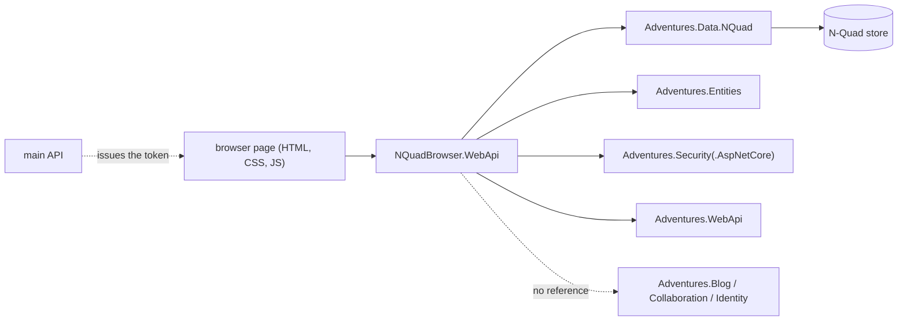

# Stage review: S8 the NQuad browser app (2026-10-31)

Branch `refactor-s8-nquad-browser` in `ai-research-blog` (Foundation needed no change: this is the proof that the libraries stand alone). Ninth stage of the decoupling refactor ([reference](../Claude-architecture-reference.md), section 7).

## What was built

1. **`NQuadBrowser.WebApi`** (new app, `src/NQuadBrowser.WebApi`): a host that lists the kinds of entity in an N-Quad store and browses and edits them. It is built from `Adventures.Entities`, `Adventures.Data.NQuad`, `Adventures.Security(.AspNetCore)` and `Adventures.WebApi` only: no blog, collaboration, identity-store or Postgres-driver project, and nothing of the main app.
2. **Generic endpoints** (`/api/browser`): the kinds (schemas, schema fields, users, roles, tenants, tenant sites, organizations, the two role-assignment kinds, exception log and signatures, each only if its schema is in the store), then the same schema-driven grid and form models the main admin uses: list with paging and sorting, new, get, create, update, delete (a tombstone). One presenter per request over the kind's own registration.
3. **Sign-in is the main API's token** (your choice): the host validates the same JWT (shared Jwt issuer, audience and signing key) and admits the Admin role only. It has no login, no user store and no credential vault. It uses the workspace's common user-secrets id (`35f5242d-e0ef-427b-8901-a1a38c165ac4`, the one on `Adventures.Common.Tests`; your standard: every project that needs credentials carries it, so a changed secret is edited in one place). In development it reads `Jwt:*` and, when set, `ConnectionStrings:Postgres` from that store, so the common store must hold the same Jwt settings the main API signs with; without a connection it runs on an in-memory store seeded with the generic model.
4. **A small standalone page** (your choice): `wwwroot/index.html`, `browser.css`, `browser.js`. A token field, the list of kinds, a paged and sortable grid, and a form built from the entity's schema (read-only fields respected, choices as dropdowns, booleans and markdown handled). No framework, no inline script or style.
5. **Its own page policy**: the shared API headers say `default-src 'none'`, which blocks any page. A real run caught that (the page rendered unstyled and its script was refused); the host now sends a policy for one page and a JSON API: scripts and styles from itself only, no inline code, no eval, no other origin, no framing.
6. **Guards** (9 tests, `NQuadBrowser.WebApi.Tests`): the project-reference closure contains no Blog, Collaboration, Identity, Postgres, Sql, main-app or MCP project (proven red by adding a Blog reference: it named Blog and Collaboration); no token or a non-Admin token is refused; an Admin sees the generic kinds and none of a feature; a kind lists its rows; an unknown kind is 404; create, edit and delete round-trip; the page is served and its policy has no inline allowance.



## Verified

- App: solution builds; `NQuadBrowser.WebApi.Tests` 9, WebApi 129, McpServer 83, LegacyImport 16 pass. Foundation untouched.
- A real two-host run: a token from the main API (Legacy mode developer sign-in) was accepted by the browser host; in the built-in browser the page signed in, listed the eleven kinds, opened Roles (Admin, Editor, Reviewer, Developer) and an entity form (Id read-only, Name editable, Save and Delete). The create, edit and delete round trip is verified through the API tests; I did not click Save in the page.

## Not verified / limits

- Against the real Postgres store: only the in-memory store was run. The same registrations and presenters run on both, but the first real use is yours (it needs the common user-secrets store to hold the Postgres connection and the same Jwt settings as the main API).
- Pointer fields (`ref:` and `refs:`) are plain id text boxes: no lookup choices (the lookup endpoint is a main-app feature). Relations (a user's role assignments) are not shown.
- The Admin check is the Admin role claim, not the main app's per-route rights; the browser does not resolve rights. It is a developer and administrator tool, run beside the main app, not exposed publicly.
- Editing schemas edits the schema entities (the same data the stores read). A bad edit to a schema can break the entities that use it; there is no undo beyond the tombstone and the store's history.
- The AppHost does not start the browser yet. Run it with `dotnet run --project src/NQuadBrowser.WebApi` (below). Not deployed anywhere: no workflow, no site.
- Angular suite not run (no client change).

## Run it

```powershell
dotnet run --project M:\Dev\repos\ai-research-blog\src\NQuadBrowser.WebApi
```

Sign in on the main app, copy a token (the browser's token field takes it), open the URL the command prints.

## Decisions

1. The AppHost should start the browser next to the API: yes or no (small change). Recommendation: yes, after you have tried it.
2. Pointer lookups and relation grids on the browser page: later, with the Angular libraries (S10), not now.
