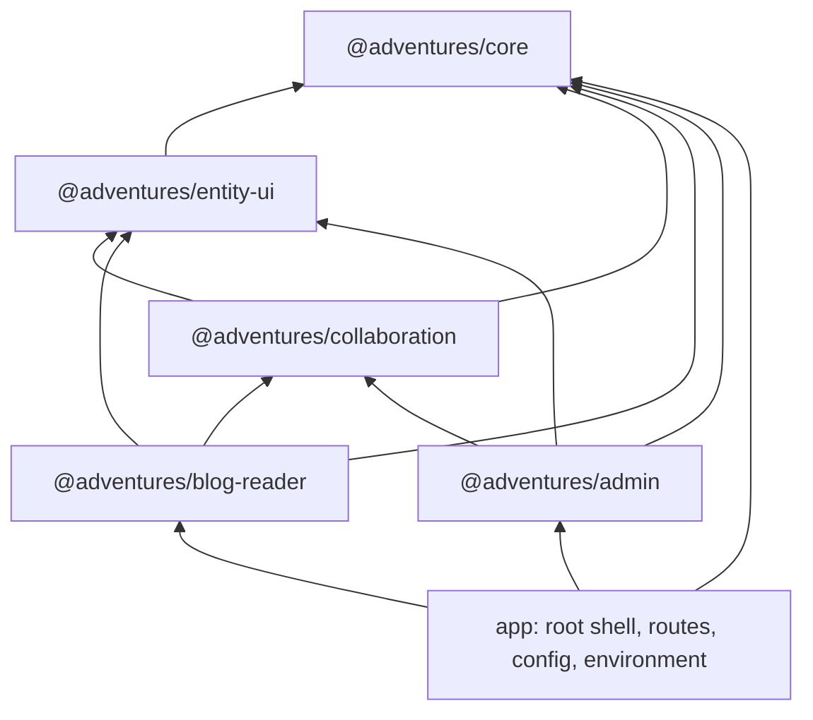

# Stage review: S10 the Angular libraries (2026-11-01)

Branch `refactor-s10-angular-libs` in `ai-research-blog` (the Foundation needed no change; this stage is all client). Eleventh stage of the decoupling refactor ([reference](../Claude-architecture-reference.md), section 7). Per D4 (server-side presenter, thin client) the libraries package views and services, not presenters.

## What was built

The Angular client was one application of 3,768 lines of TypeScript with every service importing the app's own `environment.apiUrl`. It is now five packaged libraries in the same workspace plus a thin app, cut along the same lines as the .NET side.

| Library | Holds | Depends on |
|---|---|---|
| `@adventures/core` | `API_BASE_URL`, the contract models, auth, profile and rights, entity and media services, problem banner and last-resort error handler, the correlation, auth and problem interceptors, the auth guard | nothing |
| `@adventures/entity-ui` | `adv-entity-grid`, `adv-entity-form`, `adv-relation-grid`, `adv-markdown-content`, the labels | core |
| `@adventures/collaboration` | `adv-conversation`, `adv-approval-badge`, the conversation service, the Decisions page | core, entity-ui |
| `@adventures/blog-reader` | the public pages, `adv-site-nav`, `adv-draft-badge`, `adv-content-tools`, the two public services | core, entity-ui, collaboration |
| `@adventures/admin` | the admin shell, the one grid and entity screen, plugins, exceptions, rights checklist, login and profile, their services and the server-error interceptor | core, entity-ui, collaboration |

1. **The API address is an injected setting.** `API_BASE_URL` replaces 14 services' import of the environment file; `app.config.ts` is the one place that reads it. This was the blocker: nothing could leave the app while it imported the app's own settings.
2. **Packaged, not just folders.** Each library has its own `ng-package.json` and builds with ng-packagr (`npm run build:libs`, in dependency order); a library's build resolves the others to their built packages, the app and the tests resolve them to source.
3. **The build found two real leaks**, both fixed: `content-tools` needed the signed-in person's rights (`ProfileService`, now in core), and `ProfileService` imported its own package (a circular dependency).
4. **Selectors** renamed `app-*` to `adv-*` in the libraries and their consumers.
5. **A guard holds the shape** (`library-layering.spec.ts`, 17 checks): each library imports only the ones beneath it, never reaches outside its folder (no host app, no environment file), and declares exactly the `@adventures/*` peers it uses; the app reads its environment only in `app.config.ts`. Proven red by a temporary violation (it named the file), then removed.
6. **CI**: the client job already ran `ng test` for every project; it now also runs `build:libs`. `npm run build` (the deploy) builds the app explicitly.



## Verified

- `ng test`: **153 pass** (app 21 including the 17 layering checks, core 29, entity-ui 32, collaboration 16, blog-reader 16, admin 39). The 132 tests that existed before all still pass, unchanged except for import paths; 4 new tests cover `API_BASE_URL`.
- From an empty `dist`: `build:libs` packages all five and `npm run build` builds the app.
- A real boot in the browser (dev server on a spare port, no API): the app starts from the libraries, the Posts page and header render, the API-problem banner appears (the API was down, expected), `/admin/users` redirects to the sign-in page, and the console shows no injector errors.

## Not verified / limits

- **No signed-in click-through.** The dev boot had no API, so I did not use the admin screens, the conversation, or the public site with data. The suites cover them component by component, and the page content is unchanged, but your run is the real check.
- **The libraries are not published.** Nothing goes to npm. They are consumed from source by path in this workspace. How `web-presence` (S11) consumes them is an open decision (below).
- **Not deployed yet.** Merging to main starts the Angular deploy (`client/**` changed); `Claude-verify.ps1` will check the bundle name afterwards.
- Library versions are all `0.1.0` and peers are caret ranges; there is no release process yet.
- The routes (which collections appear and their titles) still live in the app; the libraries supply screens, not a route table.

## Run it

```powershell
cd M:\Dev\repos\ai-research-blog\client\ai-blog-research-ui
npm run build:libs
npx ng test --watch=false
```

Then the usual `docs/Claude-run.ps1 -Branch refactor-s10-angular-libs` and click through the site and the admin as before; nothing should look or behave differently.

## Decisions for you

1. **How `web-presence` consumes these** (S11): (a) a private npm registry or GitHub Packages, (b) `npm pack` tarballs referenced by file path, (c) the workspace folder copied or linked. Recommendation: (b) for now, (a) once a second app is real.
2. **Scope name `@adventures/*`.** It matches the .NET `Adventures.*`; if you want a different npm scope before anything is published, now is free.
