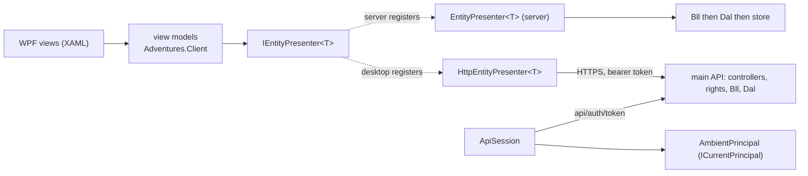

# Stage review: S9 the WPF desktop client (2026-11-01)

Branch `refactor-s9-wpf` in both repos (`Adventures.Foundation` and `ai-research-blog`). Tenth stage of the decoupling refactor ([reference](../Claude-architecture-reference.md), section 7). Before building I read AppArch chapter 17 (Rich Client Applications); its rules are now R20 to R23 in the reference.

## Decision taken at the start (yours, 2026-11-01)

D3 said "remote Dal". The server already exposes presenter-level endpoints (the grid and form contract the Angular admin uses), with rights and validation enforced there. A client-side Bll over a remote Dal would need a second, data-level API and the server would have to re-check everything anyway, because a client Bll cannot be trusted. You chose the **remote presenter**: the view models bind to `IEntityPresenter<T>`; the desktop registers `HttpEntityPresenter<T>`; only the registration differs from the server. Business rules stay on the server (chapter 17: keep sensitive logic on its own tier; R19). D3 is read as "only registrations differ", one level up.

## What was built

1. **`Adventures.Client`** (new Foundation library, `net10.0`, no UI toolkit, no ASP.NET): `ApiSession` signs in at `api/auth/token`, keeps the token in memory only, puts it on the shared `HttpClient` and records the acting principal in `AmbientPrincipal` (the S6 `ICurrentPrincipal`). `HttpEntityPresenter<T>` implements `IEntityPresenter<T>` over the existing grid and form endpoints. `ApiException` carries the status, the server's one-line title and the per-field messages, never a response body. `AddAdventuresClient(...)` and `AddRemotePresenter<T>(route)` compose it.
2. **View models** (same library, only `INotifyPropertyChanged` and `ICommand`): `SignInViewModel`, `EntityListViewModel` (schema-driven columns, paging), `EntityEditViewModel` (schema-driven fields, required check before the call, the server's field messages placed on the fields, read-only when the server says so), `ShellViewModel` (sign in, list, edit, back; a lapsed session returns to sign-in with a reason). `ScreenViewModel` is the one place a failure becomes a screen line; unforeseen exceptions raise `Faulted` for the host to log.
3. **`AiBlogResearch.Desktop`** (new WPF app, `net10.0-windows`): composition root in `App.xaml.cs`, a window that shows `ShellViewModel.Current` through data templates, three views, a file log under `%LOCALAPPDATA%\AiBlogResearch.Desktop\logs`. It lists and edits People (`api/users`); columns and fields come from the server's schema. The API address is `Api:BaseUrl` in `appsettings.json` (default `https://localhost:7052/`), overridable by the environment variable `ADVENTURES_Api__BaseUrl`.
4. **Security**: the client refuses a plain `http://` API address unless it is loopback (the sign-in sends a password); the password box is cleared after every attempt; the token is never logged or shown; no internal detail reaches the screen.
5. **Guards and tests**: architecture rule (Client references Entities and Security only, no ASP.NET package, no FrameworkReference, nothing references it; red first); 34 client tests (session, presenter, view models, shell walk, address guard, DI and the lifetime scan); 3 wire-contract tests that run `HttpEntityPresenter` against the real `NQuadBrowser` controller in memory (grid, create/read/update/delete, 401 and 403).



## Verified

- Foundation: full solution passes (Client 34, Architecture 18). App: WebApi 130, HostTests 1, NQuadBrowser 13, McpServer 83 pass. The WPF project builds with no warnings and the app starts, stays up and writes no fault log.
- One transient failure appeared once in `Adventures.WebApi.Tests` during a concurrent full run (I did not capture the test name); it did not reproduce in 11 reruns (8 isolated, 3 full). Unexplained; not hidden.

## Not verified / limits

- **Not run against the live main API.** The sign-in screen has not been used with a real account; the contract is proven in memory against the browser controller, not against `/api/auth/token` and `/api/users`. Your run is the check.
- No screenshot: nothing here drives the window; the views are untested beyond start-up.
- Only People (`api/users`) is wired. Relations (role assignments), pointer lookups, delete, and the "must change password" flow are not in the desktop yet. The desktop does not offer filtering or sorting.
- The password lives in a .NET string for the length of a sign-in attempt (a `PasswordBox` cannot bind); it is cleared afterwards but not zeroed in memory.
- Windows only; not built in CI (CI builds the web projects one by one). Not packaged or signed.
- The Foundation `build.yml` has not run on this branch (nothing is pushed).

## Run it

Start the API as usual (`docs/Claude-run.ps1 -Branch refactor-s9-wpf`, which also starts the AppHost), then:

```powershell
dotnet run --project M:\Dev\repos\ai-research-blog\src\AiBlogResearch.Desktop
```

Sign in with an account that holds the `users.manage` right (for example Admin). If the API listens elsewhere, set `$env:ADVENTURES_Api__BaseUrl = "https://localhost:7052/"` first.

## Decisions for you

1. Which entity kinds next on the desktop (Roles, then relations)? Recommendation: wait for S10, where the relation grids are packaged once for Angular and reused.
2. A delete button and the must-change-password step: now or later? Recommendation: later, with the first real use.
