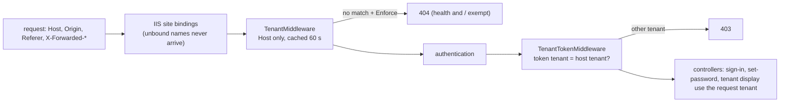

# Stage review: tenant data scoping T1, the trusted tenant (2026-11-01)

Branch `claude-tenant-scoping` in `Adventures.Foundation` and `ai-research-blog`. First of four stages in [the decision](../Claude-decision-2026-10-tenant-data-scoping.md) (graph per tenant; T1 trusted tenant, T2 scoped repositories, T3 who administers what, T4 a new tenant on a domain). T1 changes **no data and no screen**: it fixes who decides the tenant.

## What was built

1. **The tenant comes from the host the server saw, and nothing else** (`TenantMiddleware`, Foundation `Adventures.WebApi/Tenancy`). `Request.Host` is resolved against the Tenant entities (the domain, or a name under it, longest match). Origin, Referer, `X-Forwarded-Host` and `Forwarded` are never read, because the caller sets them. The answer is kept 60 s per host so the tenant store is not read on every request.
2. **A host that matches no tenant is handled by a setting, `Tenancy:Enforcement`:** `Report` (the default: serve it, log one warning per host per cache window), `Enforce` (404; the domain root `/` and `/api/health` are never refused, so the certificate request and the deploy check still work), `Off`. The development fallback (`Tenancy:FallbackDomain`) works only when the host is the Development environment; configuration cannot switch it on in a deployed site.
3. **The token says which tenant it was signed in for.** `UserAccountService` adds a `tenant` claim at sign-in; `TenantTokenMiddleware` (right after authentication) refuses a token whose claim names another tenant than the request's, with 403 ("This sign-in belongs to another site"). Machine tokens (no claim), anonymous callers and unmatched hosts are not checked.
4. **Sign-in and set-password use the host's tenant** (`SiteDomain.Tenant(requestTenant, configuration, default)`): a host that matches a tenant signs in to it; a host that matches none keeps the configured tenant exactly as before, so an install with no tenant record for its domain does not change.
5. **The tenant display** (`GET /api/tenant/current`, the box on the admin menu) now shows the same trusted tenant instead of reading Origin or Referer.



## How it answers the threats

| Threat | Closed by | Proved by |
|---|---|---|
| Host spoofing through a header | the tenant is read from `Request.Host` only | unit test, and a pipeline test with spoofed `X-Forwarded-Host`, Origin and Referer on an unknown host (404) |
| Silent default (an unknown host falls into some tenant) | `Enforce` refuses it; `Report` logs it | unit and pipeline tests; the development fallback is off unless the host is Development |
| Token reuse across tenants | `tenant` claim plus the token check | unit test, and a pipeline test with a real signed token (403 on the other tenant, 200 on its own) |
| Cross-tenant read or write | **not T1**: T2 scopes the repositories | open |

## Verified

- Foundation: full suite passes (WebApi 116 including 14 tenancy tests and the `SiteDomain` ones, Identity 44).
- App: API tests 133, host tests 7 (6 new, run through the real pipeline; 4 of the 6 go red with the two middleware lines commented out), NQuadBrowser 13, McpServer 83.
- **The real host, read-only and anonymous (my own check, 2026-11-01):** a request to production's API address with a foreign `Host` header gets an HTTP.sys 404 page (`Server: Microsoft-HTTPAPI/2.0`), not the app; adding a spoofed `X-Forwarded-Host: api.global-webnet.com` changes nothing. So IIS drops names that are not bound to the site before the app sees them: the assumption in the design holds on SmarterASP.

## Not verified / limits

- **Not deployed.** Nothing is live yet, and the default is `Report`, so a deploy changes nothing visible. Before switching to `Enforce` in production, the live tenant records must cover every host that reaches the API (see below).
- **I have not seen the production Tenant records.** The admin menu's tenant box, after the deploy, tells you in one look: it must show your tenant with no "matches no tenant" line. If it says no tenant, **do not enforce**; add the tenant first.
- A new tenant takes up to 60 s to be recognised (the cache). A deleted or renamed domain likewise.
- Under `Report` an unknown host is still served: T1 is not complete protection until `Enforce` is on, and even then it protects nothing in the data until T2 scopes the repositories.
- Tokens issued before this change have no `tenant` claim and are not checked; they expire within the token lifetime.
- The installation guide does not yet say that each tenant domain needs its own `api.<domain>` binding on the API site (T4 will).

## Switching on enforcement later

1. After the deploy, open Admin and read the tenant box (and later the log for "Tenancy: the host ... matches no tenant").
2. When every live host (`api.global-webnet.com` and any `api.<tenant domain>`) is a known tenant, set the API site variable `Tenancy__Enforcement` to `Enforce` and restart. To go back, set it to `Report`.

## Run it

```powershell
powershell -File docs\Claude-run.ps1 -Branch claude-tenant-scoping
```

## Decisions for you

1. **Rollout:** deploy with `Report` (recommended), check the tenant box and the log, then `Enforce`; or enforce straight away once you have checked the tenant records. Recommendation: `Report` first, a day.
2. **Cache time:** 60 s is the default (`Tenancy:CacheSeconds`); say if you want it shorter for tenant creation in T4.

**Decided by the human (2026-11-01):** both as recommended: deploy with `Report`, check the tenant box and the log, then `Enforce`; the tenant answer stays cached 60 s per host. The same day he filed the backlog item "one app, several domains, and a working default before any domain exists" (temporary SmarterASP addresses, aliases, tenant created on first run), to be built with T4 before beta.
