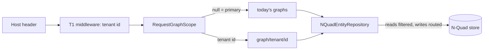

# Tenant scoping T2: scoped repositories

Branch `claude-tenant-t2` in `Adventures.Foundation` and `ai-research-blog`. Second of four stages in [the decision](../Claude-decision-2026-10-tenant-data-scoping.md) (option C, a graph per tenant). T1 decided *who the tenant is*; T2 makes the data wall: a tenant reads and writes only its own graph.

## What was built

- **`IGraphScope` and `GraphScopes`** (`Adventures.Data.NQuad/Entities/GraphScope.cs`): the rules in one place. A tenant's graph is `{registered graph}/tenant/{tenant id}`. A null key is the primary tenant, which keeps today's graphs.
- **`NQuadEntityRepository`** takes an optional scope. Every read (get, list, count, tombstones, superseded markers) drops quads the tenant may not see; every write goes to the tenant's graph. The wall is in this one class, not in each query.
- **Registration**: `AddNQuadEntityRepository(..., tenantScoped: true)`. A scoped type with no `IGraphScope` registered fails to resolve (fail closed). `EntityTypeRegistration.CreateRepository` is the only way relation provider, relation writer and guards build repositories, so they honour the scope too.
- **`RequestGraphScope`** (app host): maps the tenant the server resolved from the host (T1) to a key; `Tenancy:PrimaryTenantId` names the tenant that keeps today's graphs.
- **Scoped types**: posts, pages, categories, tags, comments, collaboration items, site settings. Shared on purpose: users, roles and assignments (T3), plug-in state, the exception log, schemas.

## Threats and tests

| Threat | Test |
|---|---|
| Cross-tenant read | each tenant lists and counts only its own; a get by another tenant's id is not found |
| Cross-tenant write | update, delete and delete-many of another tenant's id change nothing (store unchanged) |
| Writes land elsewhere | a write goes only to the tenant's graph; the same id can exist in two tenants |
| Live data hidden | the primary tenant still reads data stored in a graph the registration does not name exactly |
| Key escapes its graph | keys with `/`, `..` or blanks are refused |
| Silent default | a scoped type with no scope registered fails to resolve |

## Decision for you: the primary tenant

`Tenancy:PrimaryTenantId` (api site secret `Tenancy__PrimaryTenantId`) must be the id of the tenant that owns today's content. **Unset, scoping is off and nothing changes**, so merging and deploying T2 is safe on its own. Set it before a second tenant holds any content. I cannot tell from the code which of the four seeded tenants is the live one; the Admin tenant box shows it.

## Not covered (known gaps)

- **Uploaded images** (`IMediaStore`, table `app_media`) are not graph-based and are still shared. Needs its own tenant column; filed for T3/T4.
- **Seeded defaults** (site settings, plug-ins) are written once into the primary graphs; a new tenant starts with no settings row (T4 creates its defaults).
- **NQuad browser** is a platform tool and reads the raw store.
- **Legacy mode** (`Data:Mode=Legacy`) uses SQL Dals and has no tenant concept.
- Not verified: a live two-tenant run (tested at repository level and through the full suites; no deployed check).

## Verified

Foundation all suites pass (NQuad 91, WebApi 116, Blog 62 and others); app: WebApi 138, HostTests 7 (builds every controller with the new registration), McpServer 83, all others green.
