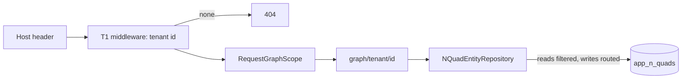

# Tenant scoping T2: every tenant has its own graph

Branch `claude-tenant-t2` in `Adventures.Foundation` and `ai-research-blog` (tool in the workspace root repo). Second of four stages in [the decision](../Claude-decision-2026-10-tenant-data-scoping.md) (option C, a graph per tenant). T1 decided *who the tenant is*; T2 makes the data wall.

**Revised 2026-11-07 on the human's decision:** the first design kept a "primary tenant" on today's graphs, configured by `Tenancy:PrimaryTenantId`. That was a shim to avoid migrating live data. Replaced: **no primary, no setting. Every tenant, DEV Main included, reads and writes only its own graph.** The live content is relabelled once.

## What was built

- **`IGraphScope` and `GraphScopes`** (`Adventures.Data.NQuad/Entities/GraphScope.cs`): a tenant's graph is `{registered graph}/tenant/{tenant id}`; the key is validated (letters, digits, `-`, `_`).
- **`NQuadEntityRepository`** takes an optional scope. Every read (get, list, count, tombstones, superseded markers) keeps only quads in the tenant's graph; every write goes to it. The wall is in this one class. Relation provider, writer and guards build repositories through `EntityTypeRegistration.CreateRepository`, so they cannot step round it.
- **Registration**: `AddNQuadEntityRepository(..., tenantScoped: true)`. A scoped type with no `IGraphScope` registered fails to resolve (fail closed).
- **No tenant, no content**: `RequestGraphScope` (app host) returns the resolved tenant's id, or throws `TenantRequiredException`; `TenantMiddleware` turns that into a 404 (not a 500). There is no shared fallback graph.
- **Scoped types**: posts, pages, categories, tags, comments, collaboration items, site settings. Shared on purpose: users, roles and assignments (T3), plug-in state, exception log, schemas.
- **`docs/Claude-nquad-tool`** (workspace root): `export` (JSONL + SHA-256), `restore` (empty table only, count-verified), `relabel` (dry run unless `-Apply`, one transaction, idempotent, refuses a missing tenant or rows already in another tenant's graph). Its type list is [`docs/Claude-tenant-scoped-types.json`](../Claude-tenant-scoped-types.json); a host test fails if it drifts from the host's registrations.

## Threats and tests

| Threat | Test |
|---|---|
| Cross-tenant read | each tenant lists and counts only its own; a get by another tenant's id is not found; over real HTTP each public site shows only its own posts |
| Cross-tenant write | update, delete and delete-many of another tenant's id change nothing |
| Silent default | a request with no tenant cannot read or write (repository) and gets 404 (pipeline); unmoved data in a shared graph is invisible to every tenant |
| Key escapes its graph | keys with `/`, `..` or blanks are refused |
| Registration forgets the scope | a scoped type with no scope registered fails to resolve |
| The relabel misses a type | host test: the tool's type list equals the host's scoped registrations |

## The live move (needs your go-ahead)

- **Backup done:** `_archive/db-backups/app_n_quads-2026-11-07-pre-T2-relabel.jsonl` (118,104 rows, SHA-256 `4888884077D5487A388EF7698313438B926C2E159D2218C0E75924BBFF0158E6`). Restore proved: loaded into a scratch table in the live database, row count and an md5 over every row identical, scratch table dropped. Restore command: `docs/Claude-nquad-tool restore -In <file> -Into app_n_quads` (works only into an empty table). The file holds password hashes: it stays outside git.
- **Dry run on live (rolled back):** 2,144 quads and 275 superseded markers would move into `…/tenant/a2b7af6d-4c2b-4732-b837-1e6d49b2c05d` (DEV Main): category 16, collaboration 552, comment 804, page 105, post 604, site setting 17, tag 46.
- **Order:** (1) relabel `-Apply` (the old code reads every graph, so the site keeps working), (2) merge and deploy this code, (3) run the relabel again for anything written in the gap (idempotent). The window between 1 and 2 is minutes.
- **After:** DEV Main's domain `global-webnet.com` and its subdomains serve the content as before. An address that matches no tenant gets 404.

## Not covered (known gaps)

- **Uploaded images** (`app_media`, 23 rows) are not graph-based and stay shared. Needs a tenant column (T3/T4).
- **Seeded defaults** (site settings, plug-ins) are written once into the shared graphs; a new tenant starts with no settings (T4 creates its defaults).
- **NQuad browser** is a platform tool and reads the raw store. **Legacy mode** has no tenant concept.
- Not verified: the deployed site after the move (that is the verify step), and a local-dev-database dry run (the local password is in user-secrets, not the vault; the live dry run, rolled back, was used instead).

## Verified

Foundation: all suites pass. App: all 17 test projects pass, including the new `TenantContentIsolationTests` (real pipeline, two tenants, one store) and `RequestGraphScopeTests`.
