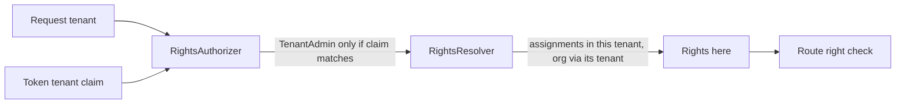

# Tenant scoping T3: rights are decided inside the tenant

Branch `claude-tenant-t3` in `Adventures.Foundation` and `ai-research-blog`. Third of four stages in [the decision](../Claude-decision-2026-10-tenant-data-scoping.md). T1 decided who the tenant is, T2 walled the content; T3 makes **what a person may do** depend on the tenant of the request.

## What was built

- **Rights per tenant.** `IRightsResolver.ResolveAsync(userName, signInRoles, tenantId)` counts only the roles assigned in that tenant: a tenant role assignment for it, or an organisation assignment for an organisation that belongs to it. A role held in another tenant gives nothing here; a person in two tenants has each tenant's rights only there. No tenant (blank id) means no rights, never the union.
- **The legacy `TenantAdmin` sign-in role is bound to the token's tenant.** It still means every tenant right, but only when the token's tenant claim matches the request's tenant (or the token has no claim: the development sign-in). A token signed in for another tenant loses it for this request. Today this only mattered with `Tenancy:Enforcement` off or Report.
- **`platform.manage`**, a new right: not part of `*` or `Rights.AllNames`, held only by a new **Platform** role (seed 019, applied once). No Admin, Editor, Reviewer or Developer role holds it, and the legacy administrator does not get it.
- **Role definitions are platform-level.** `PUT /api/roles/{id}/rights` now needs `platform.manage`. Reading the roles still needs `roles.manage`. Reason: a role is defined once for the whole platform, so a tenant administrator editing it would change what another tenant's people may do (a cross-tenant write).
- **"What you can do" (`/api/auth/rights`)** now uses the same authorizer as the routes, so it shows the rights in this request's tenant.

## Threats and tests

| Threat | Test |
|---|---|
| A role in tenant A gives rights in tenant B | role in another tenant gives nothing; two tenants each give their own rights only |
| An organisation role leaks across tenants | organisation assignment counts only in its organisation's tenant |
| A token for tenant A used on tenant B keeps admin | legacy admin role dropped when the claim names another tenant; dev token (no claim) unaffected |
| No tenant falls into everyone's rights | blank tenant gives nothing, even for the legacy administrator |
| A tenant administrator edits shared roles, or grants themselves platform power | `PUT roles/{id}/rights` needs `platform.manage`; the right is outside `*`, outside every shipped tenant role |

## Human step after deploy

The **Platform** role exists but nobody holds it, so nobody can change role rights until you assign it: Admin > Users > yourself > add a tenant role assignment for DEV Main with the Platform role. Until then the Roles list still reads; only "change what a role allows" answers 403.

## Not covered (T3b, must land before T4 creates a second tenant with an administrator)

- **Users are still one shared list.** `users.manage` in a tenant lists, edits and sets passwords for every person, and its role assignments can name any tenant. T3b scopes the list and edits to people with an assignment in the request's tenant and fixes new assignments to the current tenant. With one live tenant this exposes nothing today.
- Listing and creating tenants (`platform.manage`) is T4. Uploaded images per tenant is still open.

## Verified

Foundation all suites pass (Entities 152 including 5 new, WebApi 125 including 4 new); app all 17 test projects pass, plus 2 new role tests. Not verified: the live deploy and the Platform role assignment flow in the browser.
