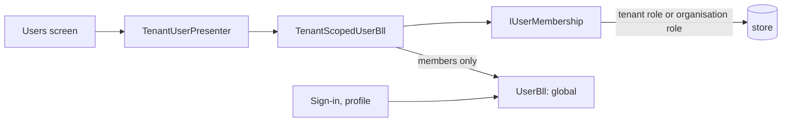

# Tenant scoping T3b: people belong to tenants

Branch `claude-tenant-t3` in `Adventures.Foundation` and `ai-research-blog` (continues [T3](Claude-2026-11-07-tenant-t3-rights-per-tenant.md)). T3 decided rights per tenant; T3b closes the gap it filed: the Users screen was one shared list.

## What was built

- **Membership.** A person belongs to a tenant when they hold a tenant role assignment for it, or an organisation assignment for an organisation of it. An assignment with **no role** is a plain membership (it gives no rights): that is how a newly added person joins. `IUserMembership` / `NQuadUserMembership` answer who belongs where from the store, once per request.
- **The people screen is scoped.** `UsersController` now uses `ITenantUserPresenter` over `TenantScopedUserBll`: list, open, edit and delete only reach members of the request tenant; a person added here becomes a member; no tenant means nothing is listed or created (fixed a bug the tests found: the person was created before the tenant was looked up, leaving an orphan).
- **Sign-in and the profile stay global.** They still use the plain `IUserBll` (people are one shared identity across tenants).
- **Assignments stay inside the tenant.** Adding a tenant role must name the administrator's own tenant (403 otherwise); an organisation role must name an organisation of it. Removing an assignment works only on this tenant's assignments (404 otherwise), so a person keeps the roles they hold elsewhere.
- **Shared people are protected.** A person who also belongs to another tenant cannot be deleted from here, and their password cannot be reset from here (it would change their sign-in everywhere and let one tenant's administrator sign in as them in another).
- **Ioc:** `[ExcludeFromLifetimeScan]` keeps a hand-wired decorator out of the lifetime scan; without it `IUserBll` and `IUserPresenter` had two implementations and lost their single registration.

## Threats and tests

| Threat | Test |
|---|---|
| Read another tenant's people | a person added in one tenant is listed only there; a second tenant starts with nobody; open by id finds nothing |
| Change or delete them | update throws not found, delete returns false, data untouched |
| Delete or reset a person of two tenants | refused (rule / 409), nothing written |
| Put a role in another tenant | tenant role naming another tenant 403; organisation of another tenant 403 |
| Remove another tenant's role | 404, nothing removed; own tenant's removed |
| Membership becomes rights | a membership-only person resolves to no rights |
| No tenant | nothing listed or created |

## Known gaps

- The person's form still lists **all** of their assignments, including those in other tenants, for a person who belongs to several (it shows that they hold a role elsewhere). Filtering the grid rows is a small follow-up.
- **User names are global**: a name already used in another tenant is "taken" here.
- An administrator can still edit the profile fields (display name, email) of a shared person who is also a member here; the sign-in is protected, the display data is shared.
- Uploaded images are still shared (separate table).

## Verified

Foundation all suites pass (Entities 158, Ioc 6, the rest unchanged); app all 17 test projects pass (WebApi 143 with 5 new controller tests, HostTests including the DI wiring). Not verified: the live deploy and the Users screen in the browser.
