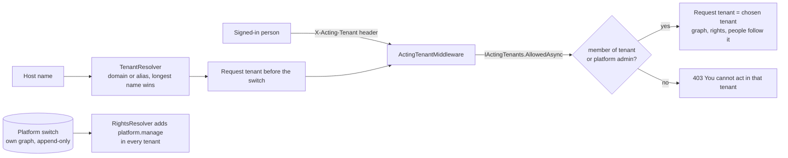

# Tenant scoping, round two of T3: the Platform switch, host aliases and the tenant switcher (2026-11-08)

Branch `claude-tenant-t3` in both repos (Foundation commits first). Replaces the Platform *role* of T3 and adds what the human asked for after trying T3 locally.

## What the human asked for

1. **Platform is a switch on the person**, not a role assignment, and Admin gets it automatically.
2. **A tenant switcher** in the tenant card: choose among the tenants you may work in; the screens then show what your rights allow there.
3. **Host aliases**: a host (for example SmarterASP's temporary domain) can mirror a tenant's real domain.

Decisions taken as recommended (the human: an unanswered recommendation is delegated): aliases are changed only by a platform administrator; Platform means "manage the platform" and does not silently grant every tenant right.

## What was built

| Part | Where | Rule it enforces |
|---|---|---|
| Platform switch | `IPlatformAdministrators`, `NQuadPlatformAdministrators`, `PlatformAdministratorBll` (Foundation) | A person's switch, outside every tenant graph and every entity type (no screen or generic update can write it); latest statement wins; the last administrator cannot be switched off; Admin gets it at startup only when nobody holds it |
| Platform right | `RightsResolver`, `Rights.Parse`, `RoleRightsEditor` | `platform.manage` comes from the switch in every tenant; a role can never hold it (the retired Platform role grants nothing; the role editor refuses it); the role checklist hides it |
| Switch endpoints | `GET/PUT api/users/{id}/platform` | PUT needs the platform right; only people of the tenant being administered; 409 for the last administrator |
| Aliases | seed 020 (`Aliases` field), `TenantResolver`, `TenantAliasEditor`, `GET api/tenant/hosts`, `PUT/DELETE api/tenant/{id}/aliases` | Plain host names only; one tenant per name, also not above or below another tenant's name; every route needs the platform right |
| Switcher | `IActingTenants`, `ActingTenantMiddleware`, `GET api/tenant/mine` | Checked on every request; anonymous callers ignored; a person may act in the tenants they belong to, a platform administrator in every tenant; rights there are the roles held there (a platform administrator with no role in a tenant holds only the platform right) |
| Client | `ActingTenantService`, `actingTenantInterceptor` (core), tenant card and `PlatformSwitch` (admin) | The choice is a request: kept in this browser, sent as a header, dropped with a reload if the server refuses it |

Threats addressed: a tenant administrator granting themselves platform power; one tenant claiming another's host name; acting in, or reading, a tenant one does not belong to.

## Verified

- Foundation: every suite passes (Entities 180, WebApi 128, Architecture 18 and the rest).
- App: every suite passes (API 155, host tests 11, McpServer 83, NQuad browser 13 and the rest).
- Angular: all projects pass (admin 46, core 31) and `build:libs` and the app build succeed.
- **Not verified:** the screens in a browser against live data, and the live data steps below.

## What happens when you run it against the live store (`https-live`)

1. Seed 020 is applied (adds the `Aliases` field to the Tenant schema).
2. At startup nobody holds the switch yet, so **Admin becomes a platform administrator** (logged once).
3. The old Platform role stays in the live data, but grants nothing now. It is dead data: remove it with the nquad tool when convenient (not urgent).
4. The soft-deleted T3 collaboration item is not restored by this work.

## Test steps

1. Run `.\docs\Claude-run.ps1 -Branch claude-tenant-t3`, sign in as Admin.
2. **Platform switch:** Users > a person: the Platform switch shows; Admin is on. Try switching Admin off: refused (last administrator). Switch a second person on, then off.
3. **Tenant switcher:** the card shows a "Work in" list; pick another tenant: the page reloads and Posts, Collaboration and Users show that tenant's data. Go back.
4. **Aliases:** open "Host names" in the card, choose DEV Main, press Mirror: `localhost` is now an alias of DEV Main and the development fallback is no longer needed for localhost. Remove it with the cross. Try mirroring `localhost` to a second tenant after adding it to the first: refused.
5. Sign in as `test-reviewer01` (no platform): no Host names section, switch shown read-only on a person, only the tenants that person belongs to are offered.

## Open

- `Claude` and `test-reviewer01` still hold roles only in Adventures Edge (the T3 decision, tabled by the human). With the switcher they can work in Adventures Edge, where their roles are.
- The alias answer per host is cached for up to a minute (`Tenancy:CacheSeconds`).
- Media per tenant and seeded defaults for a new tenant are still open (T4).
