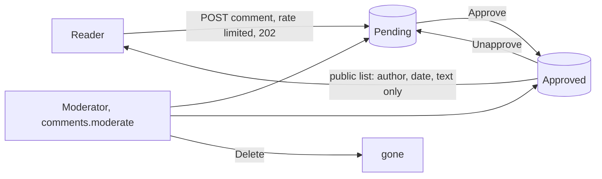

# Stage review: admin menu trim, Dashboard, and visitor comments with approval (2026-11-19)

Branch `claude-session-2026-11-19` in the app and Foundation repos. Beta crunch step 1 (human request, 2026-11-19). Nothing is merged or deployed.

## What was built

1. **Menu:** Blogs and Contacts are gone (test first: `AdminMenuPluginTests`).
2. **Dashboard** (`/admin/dashboard`, now the admin home): post and page counts, what waits for a person (collaboration items, active exceptions, comments to approve), the draft posts and pages with links to their editors, and the **tenant panel** (the tenant the domain names, "Work in", host names) moved here from the left menu. The admin frame still loads the tenant facts once, because the Users screen needs the platform switch.
3. **Visitor comments with approval** (legacy BlogEngine Comments page, trimmed):
   - A reader sees the approved comments under a post and a form (name, optional e-mail, comment, a hidden honeypot field).
   - A new comment is always **Pending**; the status is never read from the request.
   - Admin > Comments lists them (filter All, Waiting, Approved) with Approve, Unapprove and Delete for the ticked rows; Delete asks first.
   - The right is `comments.moderate` (Admin has it through `*`; give it to other roles on the Roles screen). A pending count badge sits on the menu entry and on the Dashboard.

## Security notes (threats addressed)

- **Spam flood:** per-IP limit on the submit (`RateLimit:CommentsPerMinute`, default 3), request size 16 KB, at most 200 comments waiting (then 409).
- **Robots:** hidden honeypot field; a filled one is answered like a real comment and stores nothing.
- **Script injection:** text is stored and shown as plain text (Angular interpolation, never Markdown or HTML); control characters are stripped.
- **Privacy:** the public list returns no id and no e-mail address; the e-mail is shown only to a moderator.
- **Tenants:** the comment type is tenant scoped like posts (listed in `docs/Claude-tenant-scoped-types.json`; a host test keeps the list equal to the registrations).
- **Not stored:** no IP address or user agent.

## Verified

Foundation: all suites pass (Blog 78 incl. 16 new). App: API 175 (new: dashboard rules, comment controllers, route guard), host 11, McpServer 83. Client: core 41, entity-ui 32, collaboration 18, blog-reader 23, admin 58, app 31; libraries and app build.

## Not verified

The screens have not been opened in a browser, and the new seed (021) has not run against a real Postgres store. It runs once at startup on the first deploy.

## Left out of the beta (on purpose)

Spam scoring and filter rules, pingbacks, replying from the admin, importing the old BlogEngine comments, e-mail to the author, comment counts on the post list. Beta rights: only Admin moderates until you give the right to a role.

## After approval

Merge Foundation first, push, `backup --mirror`, watch the deploys, `Claude-verify.ps1`; the first start seeds the comment type.
