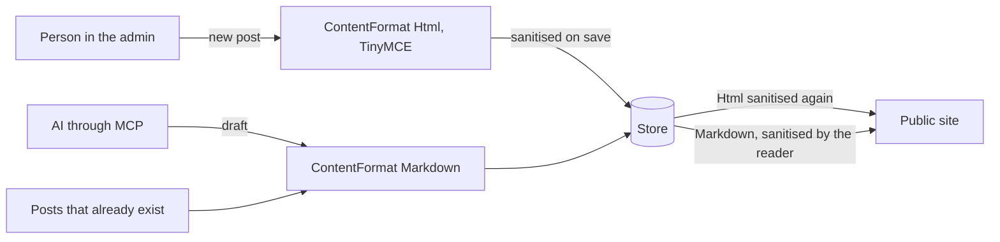

# Stage review: the Word-like document editor (TinyMCE) and the content format (2026-11-19)

Branch `claude-session-2026-11-19e` in the Foundation and app repos. Follows the human's review of the first visual editor: people who write blogs expect a Word-like page with alignment, colours and a formats menu, as in BlogEngine, which Markdown cannot express. Nothing is merged or deployed.

## Decision

- **Markdown cannot be Word-like** (no alignment, colour or underline), so a comparable Markdown editor does not exist. As the human asked, the editor is **TinyMCE**, the editor BlogEngine uses (it ships 4.2.4). The newest open-source (MIT) line is **TinyMCE 6.8.6**; versions 7 and later are GPL or commercial, so they are not used.
- **Two formats, no conversion.** Every post and page has a `ContentFormat`: **Html** for what a person writes in the admin (TinyMCE) and **Markdown** for what an AI writes through MCP and for every post that already exists. Nothing is converted. A post keeps its format for life. The TipTap Visual / Markdown / Preview views stay for Markdown posts.
- **Existing content (my call):** the legacy blogs the human keeps live on adventuresontheedge.net (the BlogEngine site). The imported posts in this store and the AI-written ones stay Markdown. global-webnet.com holds no production blogs, so nothing needs migrating.

## What was built

- **Foundation:** seed 022 (`ContentFormat` on Post and Page, default Html for the admin form), `ContentFormats` rules (missing is Markdown, unknown refused, cannot change, Html sanitised), `HtmlContent` (HtmlSanitizer), public posts and pages carry the format, revisions copy it, an AI cannot propose a Markdown revision of an Html post, AI drafts are always Markdown.
- **Client:** `adv-html-editor` (TinyMCE 6: formats, bold, italic, underline, strikethrough, alignment, lists, indent, text and background colour, links, pictures, tables, find and replace, fullscreen, source code), `adv-html-content` (the reader), the entity form picks the editor from the format, the reader shows Html posts and pages.
- TinyMCE is **not in the app bundle**: its files are copied to `/tinymce` and the script loads only when an Html field is opened. Initial bundle 916.62 kB (unchanged by this stage; the 1.00 MB error budget was the earlier failure).

## Threats addressed (security first)

- **Stored script in a rich-text post:** HTML is cleaned when saved and again when served (scripts, event handlers, frames, forms, style sheets, `javascript:` and `data:` links, resource-loading CSS removed; alignment and colour kept; new-window links get `noopener noreferrer`). 26 sanitiser tests, plus tests that unsafe markup already in the store is cleaned on the way out.
- **Why the reader trusts the server's HTML:** Angular's own sanitiser would strip the alignment and colour; `adv-html-content` is the only place that trusts HTML and only for the public content API.
- **Pictures** go to the media route (server checks the file type); nothing is pasted inline.
- **Dependencies:** `tinymce` 6.8.6 (MIT, assets only) and `HtmlSanitizer` 11.0.26 (MIT).

## Verified

Foundation: all suites pass (Blog 112, 17 new). App API: all pass except five tests that read source files by path and cannot run with the redirected build output I had to use because a dev server held the build files (they passed on the earlier run and are unrelated to this change). Client: core 41, entity-ui 56 (11 new), collaboration 22, blog-reader 25 (2 new), admin 58, app 31; libraries and the production build pass.

## Not verified

TinyMCE was **not run in a real browser** (the tests use a stand-in). Please check the toolbar, picture upload, dark mode, a phone-width screen, and saving then viewing an Html post on the site. The seed has not run on a real store yet.

## Left for later

Converting a Markdown post to Html (a button), a media library, using the document editor for the conversation reply box, and a "format" choice when creating a post (new admin posts are always Html).
