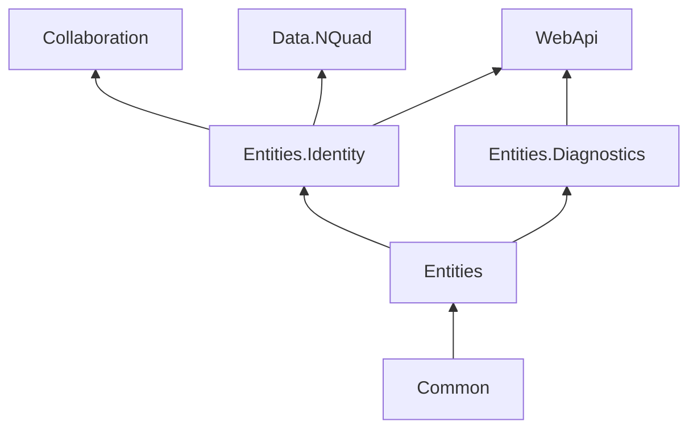

# Stage review: F1, `Adventures.Entities` split into three projects

Branch `claude-step2-friction` (Foundation, app, root). Nothing merged or deployed. Finding F1 of `docs/Claude-review-2026-11-foundation-scan.md`.

## What changed

- `Adventures.Entities` is now the generic dynamic entity model only (`Core/`, `Schema/`).
- **`Adventures.Entities.Identity`** (new): User, Role, Tenant, Organization, Blog, the two role-assignment entities, `Rights`, `RightsResolver`, `RoleRightsEditor`, `RoleRightsUpgrade`, tenant resolver and aliases, platform administrators, acting tenants, user membership, the user Bll and presenter.
- **`Adventures.Entities.Diagnostics`** (new): the exception log and exception signature entities, Blls, presenters, `DiagnosticsReader`.
- `EntityConstants` lost the owned members: `UserConstants`, `IdentityConstants` (Identity project) and `ExceptionLogConstants`, `ExceptionSignatureConstants` (Diagnostics project). About 230 call sites were rewritten mechanically.
- Namespaces were kept (`Adventures.Entities`) on purpose: a split namespace means no consumer changed a `using`. Cost: the namespace no longer tells you the package. Recorded as the decision; revisit if it confuses.

## Verified

- Guard test written first and seen failing (`Entities_is_the_generic_model_with_identity_and_diagnostics_entities_in_their_own_projects`), then green; the recorded project graph in `DependencyRulesTests` was updated on purpose.
- Foundation and app solutions build with 0 errors; every app suite passes. Foundation: every suite passes except one run where `AiTriageTests.TheHourlyCap_StopsFurtherCalls` failed under a parallel full run; it passed 5 of 5 reruns alone and in its project, and touches no moved code (a load-sensitive flake, not investigated further).

## Not done (next stages)

- F3 (guards, seeds and the Npgsql store out of `Adventures.Data.NQuad`) and F10 (reusable controllers out of `AiBlogResearch.WebApi`) touch the same registrations and follow one at a time.
- Blog, Client and MEF do not need the Identity project; WebApi, Collaboration and Data.NQuad do.
