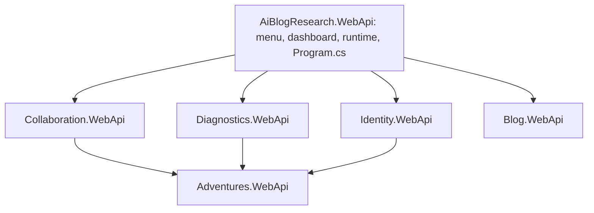

# Stage review: F10, reusable controllers leave `AiBlogResearch.WebApi`

Branch `claude-step2-friction` (Foundation, app, root). Nothing merged or deployed. Finding F10 of `docs/Claude-review-2026-11-foundation-scan.md`, three commits (F10a, b, c).

## What changed

The app host kept only what is its own composition: `AdminMenuController` (menu built from plug-ins and the review queue), `DashboardController` and `RuntimeController`. Everything else moved to Foundation libraries, each with one registration call on `AddControllers()`:

| Project | Controllers | Call |
|---|---|---|
| `Adventures.Collaboration.WebApi` | Collaboration, CollaborationAuthoring, Conversation, Decisions, Plugins, `RequiresPlugin` | `AddCollaborationControllers()` |
| `Adventures.Diagnostics.WebApi` | AdminDiagnostics, McpDiagnostics, AdminExceptions, ClientErrors, Health, `HealthSnapshotCache` | `AddDiagnosticsControllers()` |
| `Adventures.Identity.WebApi` | Auth, M2MAuth, Users, Roles, Profile, Lookups, Tenant, `PlatformUserVisibilityFilter` | `AddIdentityControllers()` |

- **One new seam.** The collaboration `migrate` endpoint needed the Blog. `MigrationReport`, `MigratedPost` and a new `ICollaborationMigration` moved into `Adventures.Collaboration`; the Blog implements and registers it. The new project therefore does not reference the Blog (it would have inverted Blog to Collaboration).
- **One constant duplicated on purpose.** `CollaborationAuthoringController.RequiredScope` repeats `content.draft`; a test keeps it equal to the Blog's.
- Namespaces changed to `Adventures.<Area>.WebApi` (unlike F1, these are new libraries, so a real namespace was worth the test `using` edits).
- Plug-in switches ride with the collaboration project because they gate it; a host with plug-ins but no collaboration would want them elsewhere (low priority).

## Verified

- Ratchet test `ReusableControllersLeaveTheHostTests` written first: the host assembly may declare only the three listed controllers; it shrank with each slice.
- The route-right guard and the role matrix tests scan the host plus the Identity, Blog, Collaboration and Diagnostics assemblies, so no moved route escaped the "every route names a right" check.
- Foundation and app solutions: every suite passes, including the host test that builds every controller in Legacy mode.

## Not done / watch

- **The tests of the moved controllers still live in `AiBlogResearch.WebApi.Tests`** (with new `using`s). Moving them next to their libraries needs a web test harness in the Foundation; left for later.
- `Program.cs` did not shrink (511 lines; it gained three registration lines and lost no logic). Splitting its composition is not part of this stage.
- Not run: CI, a publish, the live site. Verify after deploy with `Claude-verify.ps1`.
