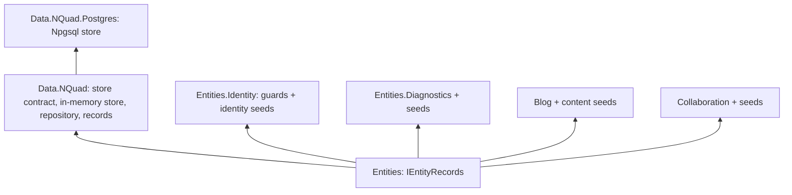

# Stage review: F3, `Adventures.Data.NQuad` holds the store, not the rules, driver or feature seeds

Branch `claude-step2-friction` (Foundation, app, root). Nothing merged or deployed. Finding F3 of `docs/Claude-review-2026-11-foundation-scan.md`, built as three commits.

## What changed

1. **F3a, the rules left the store.** `LastTenantAdministratorGuard` and `SelfLockoutGuard` moved to `Adventures.Entities.Identity`. They used to open the store and build repositories; they now read through a new store-agnostic seam, `IEntityRecords` (in `Adventures.Entities`, implemented by `NQuadEntityRecords` in the store project, tenant-scoped like every read). Hosts register the rules with `AddIdentityRelationGuards()`; `AddNQuadRelationWriter()` no longer registers them. **A host that forgets the call has no last-administrator or self-lockout protection**, so the main API calls it and four test setups were updated; the NQuad browser host does not use the relation writer.
2. **F3b, the driver left the store.** `NpgsqlNQuadStore` and `schema-nquads.sql` moved to a new `Adventures.Data.NQuad.Postgres` project. `Adventures.Data.NQuad` no longer references Npgsql or Dapper. Namespaces kept.
3. **F3c, seeds went to their features.** The 17 feature seeds moved out of the store project into the project that owns each (Identity 004/005/018/020, Diagnostics 002/003, Blog 006/007/008/011/013/021/022, Collaboration 014/015/017, MEF 016, Blog.Legacy 009/010/012). The store project keeps only `seed.nq`. Each project copies its seeds to `Sql/seed` in the output, so hosts and tests read the same paths as before.

## Verified

- Three guard tests written first and seen failing, then green: no `IRelationChangeGuard` class in the store project; no Npgsql/Dapper there and the Postgres project exists; the store project ships only `seed.nq`. The recorded project graph was updated on purpose.
- The main API output carries the same 21 seed files with identical MD5 hashes before and after (checked on disk). The browser and MCP hosts still get every seed they read.
- Foundation and app solutions: every suite passes. `LegacyImport.Tests` (not in the solution) passes 16 of 16 after its seed lookup learned that seeds live in several projects. The legacy seed generator test and the import tool now look in `Adventures.Blog.Legacy`.

## Not verified / watch

- Deploy: the CI workflows were not run. Seeds reach the publish folder the same way they did (content copied from referenced projects); I checked the build output, not a publish. Verify after deploy with `Claude-verify.ps1` and a look at the live seeds applied.
- Nothing seen against the live database.

## Next

F10 (reusable controllers out of `AiBlogResearch.WebApi`) is the largest remaining item.
