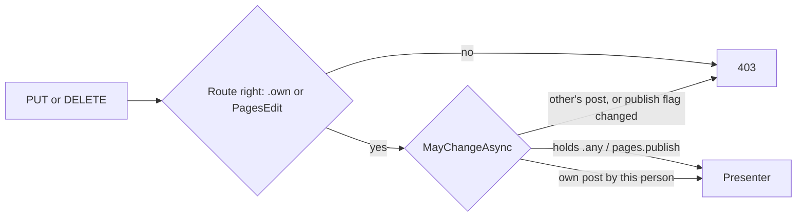

# Stage review: friction items (beta crunch step 2)

Branch `claude-step2-friction` in all three repos. Nothing merged or deployed.

## What was built

1. **Reply box opens in Preview on a collaboration item.** Posts keep the typing box. The quick replies (Approve, Change request, Ask, Backlog) switch to the editor because they pre-fill text. An empty preview says "Press the pencil to write a reply."
2. **Action buttons repeated at the end of the editor page.** One template, rendered above the form and after the conversation. The bottom Save asks the form to submit, so it saves exactly what the top one does.
3. **Test steps pop out.** A toolbar button on a saved collaboration item opens `/steps/:id` in a new window: a bare page (no admin frame) showing only the item's "Test steps" section.
4. **S2b, own versus any (security).** `AdminEntityControllerBase.MayChangeAsync` can refuse an update or delete with 403 after the route right passed.
   - Posts: the route needs `posts.edit.own` / `posts.delete.own`; a post someone else wrote needs the `.any` right. Before this, an own-only person could change nothing.
   - Pages: flipping `IsPublished` (the Publish eye) needs `pages.publish`; other edits need only `pages.edit`.

## Verified

- Tests written first and seen failing: conversation (3), admin entity (1), test-steps popout (5), OwnVersusAny (7).
- Client: all projects pass, libraries build, production build 922.91 kB (over the 600 kB warning, under the 1 MB error limit; 918 kB before).
- Foundation: every suite passes. App: every suite passes (API 190, host 11, MCP 83).

## Not verified

- Nothing was seen in a browser. In particular: the pop-out window must carry the sign-in over (it relies on the browser copying `sessionStorage` to a window opened from the page; if it lands on the sign-in page, say so and I will pass the token another way).
- No role holds an own-only right today (Editor holds `.any`), so S2b changes no live behaviour until such a role exists.

## Test steps

1. Open a collaboration item. Expect: the reply box shows Preview with the hint; the pencil opens the editor; Ask opens the editor with "Question: ".
2. Open a post, scroll to the end. Expect: a second toolbar; its Save saves.
3. On a collaboration item press the new window icon. Expect: a window with only the Test steps.
4. As an Editor, publish a page. Expect: works (Editor holds `pages.publish`).
