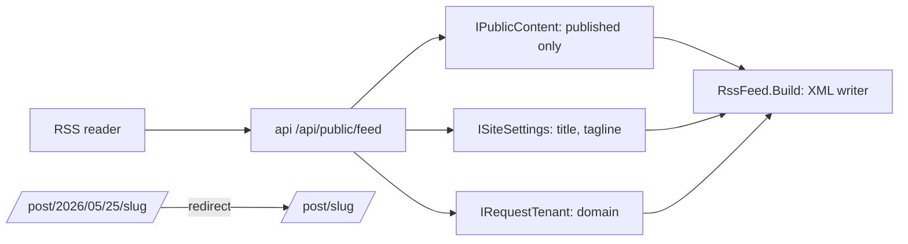

# Stage review: RSS feed, old BlogEngine post addresses, diagnose script

Branch `claude-session-2026-11-19b` (Foundation, app, root). Not merged or deployed. Chosen by me ("pick for me") from step 2 as the next visible, testable gaps for a blog people will actually read.

## What changed

1. **RSS feed.** `GET /api/public/feed` (anonymous) returns RSS 2.0 of the 20 newest published posts. `RssFeed.Build` (Adventures.Blog) writes it with an XML writer, so titles with `<`, `&` or quotes stay well-formed; item links are `https://<tenant domain>/post/<escaped slug>`; no author, no ids, drafts skipped even if passed. `FeedController` (Adventures.Blog.WebApi) never asks for drafts, caches 5 minutes, and answers 404 when the request tenant has no domain rather than guess a host. The header has an RSS icon linking to it.
2. **Old BlogEngine addresses.** `/post/yyyy/MM/dd/slug` (and its `/rate/n` form) redirect to `/post/slug`. The live exception log showed NG04002 route errors for exactly such addresses (a 2026-05-25 post and a rating link) as recently as this afternoon.
3. **`Claude-diagnose.ps1`** printed `System.Object[]` rows on Windows PowerShell 5.1 (a JSON array arrives as one object); it now prints one row per exception.

## Verified

- Tests first, seen failing: 6 builder tests, 3 controller tests, 3 legacy-address tests, 1 header-link test. The route-right guard required the feed to be listed as anonymous on purpose (it is, with its reason).
- Foundation and app solutions: every suite passes. Client: 36 tests pass; production build 923.28 kB.
- Diagnose script rerun against production: readable rows. Recent server exceptions since the deploy: none (only the client route errors above).

## Not verified / limits

- Not seen in a browser or an actual feed reader. The link base comes from the tenant domain, so on production it will read `https://global-webnet.com/...`; check that it matches the address people use (bare versus www).
- No `<link rel="alternate">` in the page head (the API address is only known at run time); readers that auto-discover feeds will not find it yet.
- Comments are not in the feed; the feed shows descriptions, not full content.
