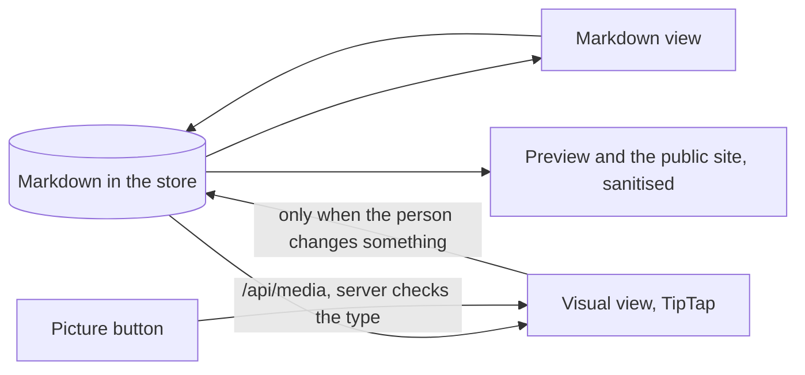

# Stage review: the visual (WYSIWYG) editor and the kept reply draft (2026-11-19)

Branch `claude-session-2026-11-19b`, app repo only (client). Crunch step 2, first stage. Nothing is merged or deployed.

## What was built

1. **A visual editor for every Markdown field** (posts, pages and the rest that the entity form draws). Each Markdown field now has three views: **Visual** (type on the page, with a toolbar: bold, italic, strikethrough, inline code, headings, bulleted and numbered lists, quote, code block, divider, link, picture, tables shown as tables), **Markdown** (the text, the default) and **Preview** (the site's own renderer, which also draws Mermaid).
2. **The stored text stays Markdown.** The Visual view reads and writes Markdown (TipTap 3 with its Markdown extension). So an AI author, a diff and the sanitised public reader work exactly as before, and no HTML is stored or sanitised on save.
3. **An unsent reply is kept in the browser** per item and restored when the item is opened again; it is forgotten when sent or emptied (backlog item of 2026-10-24).

## Safety choices

- **No silent rewrite:** opening the Visual view changes nothing and does not mark the form as changed; the Markdown is replaced only after an edit. Tests cover this.
- **Nothing is lost on an unrelated edit:** a Mermaid block stays a Mermaid block, and a table stays a table (tested).
- **Links:** only `https://`, `http://`, `mailto:` and site paths can be set; `javascript:` and similar are refused with a message.
- **Pictures:** uploaded through the existing media route (the server decides what is a picture); a refusal is shown in the server's words.
- **Rendering path unchanged:** readers still get the sanitised renderer; the editor adds no new way to publish script.
- **Dependencies:** `@tiptap/core`, `pm`, `starter-kit`, `markdown`, `extension-image`, `extension-table` (MIT). They load only in the admin (the public reader does not use the editor).

## Verified

Client: core 41, entity-ui 45 (13 new), collaboration 22 (4 new), blog-reader 23, admin 58, app 31; libraries and the app build.

## Not verified

The editor has not been used in a real browser (the tests run in jsdom), so look and feel, the toolbar layout on a phone, and typing feel are unchecked. The bundle impact was not compared with a baseline; the public pages do not import the editor.

## Left for later

The conversation reply box still uses the plain Markdown box (the Visual view could be offered there too). Constructs the editor cannot draw (raw HTML, footnotes) are kept safe by leaving the default on Markdown. A media library screen, alt text and resizing remain in the backlog.
