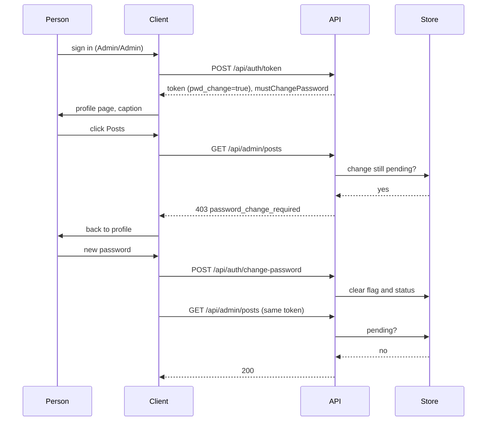

# Stage review: the password change is enforced on first sign-in

Branch `claude-session-2026-11-20` (Foundation, app, root). Not merged or deployed. Chosen by me from step 2 ("pick the next"): the backlog item "a first-run that forces the default passwords to change", partly built before.

## What was there

A seeded account (`Admin`/`Admin`, `Claude`/`Claude`) or a password set by an administrator is flagged must-change. Login reported the flag and the client sent the person to the profile page with a caption, but **nothing enforced it**: the person could click away and use the whole admin, a reload forgot the flag, and the API never looked at it. A reminder, not a rule.

## What changed

1. **The token carries a mark.** A flagged sign-in gets the claim `pwd_change=true` (`WellKnownClaims.PasswordChange`).
2. **The server enforces it.** `PasswordChangeRequiredMiddleware` (Adventures.Identity.WebApi, after authentication, before authorization) refuses every `/api/...` call from a marked token with **403** and `code: password_change_required`, except sign-in and the password endpoints (`/api/auth/*`), the person's own profile (`/api/profile/me`), the public site (`/api/public/*`), `/api/runtime` and `/api/health`. The mark is not trusted alone: `IPasswordChangeGate` asks the store (credential flag or user status, the same rule login uses), so the **same token works the moment the password is changed** (no second sign-in). Unmarked tokens and anonymous callers are never asked, so ordinary requests cost nothing extra. A marked token on a host with no gate (Legacy mode) is refused, never waved through.
3. **The client holds the person to the form.** The route guard sends a flagged person to `/profile` (remembering where they were going); the interceptor does the same on the 403 code; the flag survives a reload (kept per browser tab); after the change the person returns to the page they wanted.

## Threat addressed

A default or administrator-set password working like any other. Before, a stolen or guessed default (`Admin`/`Admin` on a fresh install) gave full access with no change forced; now it gives access to the password form only.

## Verified

- Tests first, seen failing: 4 Foundation tests (gate rule, mark on the token), 21 middleware tests (refused paths, allowed paths, cleared flag, unmarked and anonymous callers, missing gate, broken subject), 6 client tests (guard, interceptor, reload memory).
- Foundation and app solutions: every suite passes (app API 217, Identity 50, host tests 11). Client: all projects pass (core 47); production build 923.87 kB.

## Not verified / limits

- Not exercised in a browser or against the live store. Test it by signing in as a flagged account (Run line below).
- The mark is set at sign-in only: an administrator who flags an already signed-in person does not hold that person's current token; it applies from their next sign-in (tokens are short-lived).
- Machine (M2M) tokens and the MCP server are untouched: they carry no mark.
- The allowed list is by path prefix; a new public or auth route outside those prefixes is held until added.
- No setting to switch it off; a deliberate choice for security (a development host can change the password once).
