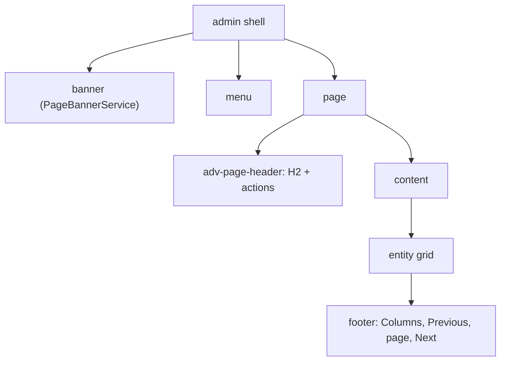
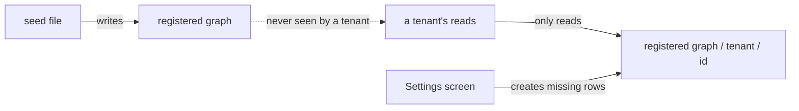
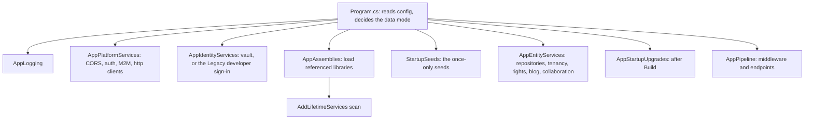

# Stage review, 2026-11-20: admin layout standard, gears, tag cloud, comments switch, startup split

What changed since the last review, what was verified, and what is for the human to decide. Everything below is on `main` and deployed
except the last section (the startup split and the tool inventory, committed on `claude-session-2026-11-24`, not merged).

## 1. Admin page standard (live)

Every admin page now starts the same way: the H2 at the left with the page actions right-justified on the same line (`adv-page-header`), a banner
under the site menu when a page has something to say (`PageBannerService`), the grid's **Columns** button at the foot of the grid before
**Previous**, and a 12 px gap above the content. Profile and Sign-in use it too.

## 2. The gears for every load (live)

`bindSpinner(loading)` ties a page's loading flag to the global gears and `adv-busy` does the same for the lazy editors, so no "Loading..."
line is left. The Dashboard starts the gears, loads its numbers first, creates the health pill last, and stops the gears when the health check
has answered.

## 3. Tags (live)

Admin > Tags is a cloud of pills (`adv-tag-cloud`): size by use, the count as a badge, a click lists the posts (`/tag/:name`), a pencil edits.
The same control sits in a labelled **footer zone** at the foot of the public Posts page, the first place a footer widget will be dropped.

## 4. Comments switch and a lesson about seeds (live)

`CommentsEnabled` closes the comment form site-wide and refuses new comments; existing ones are kept. Its first version was a seed and did not
show under Settings, because **a seed writes outside every tenant's graph**, so nothing seeded after the tenant work is visible to a tenant. The
Settings screen now creates any known setting a tenant lacks. The rule for later: reference data a tenant must edit is created per tenant by code,
never by a seed.

## 5. Startup split (committed, not merged)

`Program.cs` went from 512 to 160 lines. The sections moved verbatim, by line range, into `src/AiBlogResearch.WebApi/Startup`:

**The split broke something real, and the tests caught it.** The `AddLifetimeServices()` scan registers Bll, Dal and presenter classes from the
assemblies *already loaded*. While one long method used types from every library, .NET had loaded them all before the scan; once split, the
exception-log and diagnostics libraries were not loaded yet and their presenters were never registered. The Legacy-mode host test failed with
"Unable to resolve IExceptionLogPresenter". `AppAssemblies.EnsureReferencedLoaded()` now loads every referenced library first, so the scan no
longer depends on how the code is arranged. A second test (the DevLogin guard) read `Program.cs` as text and now reads the Startup folder too.

Verified: the full app solution, 221 WebApi tests and 11 host tests, all pass. Not verified: a run against the live store (the host tests use
the in-memory store). Please start it once locally before this merges.

## 6. Tools, widgets and the beta (documents only)

Two documents carry your vision: [the backlog](../Claude-backlog.md) (widgets and zones, tools in two layers) and
[the MCP tool inventory](../Claude-mcp-tool-inventory-2026-11.md), which sorts today's tools into the two layers. Its finding: the 19 authoring,
collaboration and diagnostics tools are already thin forwarders to the app's own API with the caller's token, so Layer 1 exists today; the
~20 `blogai_*` research tools read the legacy database directly and are MCP-only. What blocks extensibility is that the tool list is a hard-coded
array and a `switch` in `McpController`.

## For the human

1. **Test the startup split locally** (the one-line launcher) before it merges; it changes nothing you can see, so the check is that the app starts
   and Settings, Exceptions and the Dashboard load.
2. **Moving the moved controllers' tests into Foundation** (the Remaining item) is about 20 test files, because the controllers left the app in F10
   but their tests stayed. I did not start it unattended: it needs new Foundation test projects (one per library, or one combined
   `Adventures.Controllers.Tests`), its own helpers (the fakes the tests share), and changes to what both repos' CI runs. I lean to one project per
   controller library, moved one library at a time, Foundation first.
3. **The three questions at the end of the tool inventory** (does a Layer 1 tool ever have its own code, do the diagnostics tools stay Layer 1,
   where does a basic search live).
