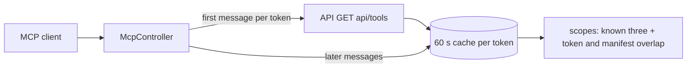

# Stage review: manifest cache, derived scopes, vulnerability cleanup (2026-11-20)

Branch `claude-session-2026-11-27` (two commits, not merged or deployed).

## What was built

1. **Manifest cache.** `McpController` kept asking the API for `GET api/tools` on every JSON-RPC message. It now remembers the answer per token (SHA-256 of the Authorization header) for 60 seconds. A failed or refused answer is never kept, so an outage clears on the next message.
2. **Scopes from the manifest.** The endpoint gate knew three scopes by name. When a token holds none of them, the controller now accepts any scope that both the token and a manifest tool carry. The API already filtered the manifest by the token, so a plug-in with a new scope needs no controller edit. A token with an unrelated scope (`mcp.hello`) is still refused.
3. **Vulnerabilities.** `package.json` `overrides` pins `vite ^8.3.8` for `@angular/build`, vitest and the ssl plugin (two high advisories gone). The AppHost SDK moves from 13.5.3 to 13.6.5, which clears the Aspire.Hosting advisory; `dotnet list package --vulnerable` is empty.

## Evidence

- Tests first: three new `McpControllerTests` failed, then passed (once per token, a failed manifest is not remembered, a plug-in scope is reachable).
- Every .NET suite passes (McpServer.WebApi.Tests 91). Client: `build`, `build:libs` and 88 tests pass.

## Not done, needs the human

- `tinymce <=7.9.2` (high XSS): the fix is tinymce 8, a breaking bump of the document editor. Needs a browser check of the editor after the bump.
- `katex` through `mermaid` (low): the fix is mermaid 12.3, also breaking.

