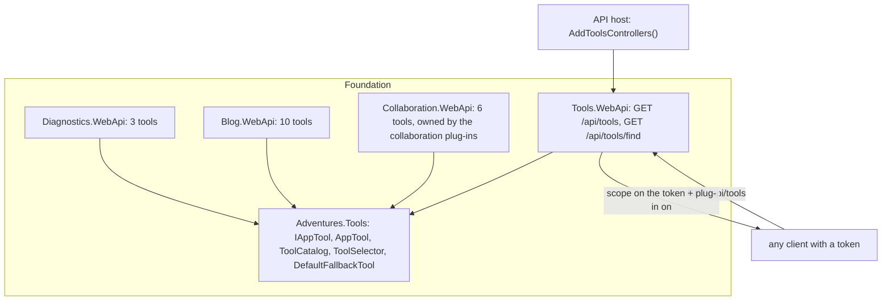

# Stage review, 2026-11-20: tool manifest and the MCP server reading it (stages 1 and 2 of the tool plan)

Stages 1 and 2 of [the tool inventory](../Claude-mcp-tool-inventory-2026-11.md) are built on the session branch: the `IAppTool` seam with its
selector chain, a manifest of the 19 existing tools served at `GET /api/tools`, and **the MCP server now builds its tool list and its calls from that
manifest** instead of its own hard-coded array and `switch`. Not merged or deployed.

## What was built

- **`Adventures.Tools`** (no references at all, pinned by a guard test): `IAppTool` is a description of an API call (name, description, input
  schema, the **scope** the API enforces, method, path) that also decides for itself whether it matches a search key (`CanHandle`). The default
  matches by exact name, by every word of the key in the name or description (a grep), or by a small misspelling of the name (fuzzy); a tool author
  overrides it. `ToolSelector` is the chain of responsibility (first tool that handles the key wins; an optional `IToolGuesser` for an AI may only
  choose among the offered tools; `DefaultFallbackTool` always handles, so a search never comes back empty). `ToolCatalog` lists what a caller may
  use: the tool's scope on the token and, when the tool belongs to plug-ins, any one of them being on.
- **The 19 tools as data**, next to the controllers they describe, copied from the MCP definitions so descriptions and schemas are identical.
- **`GET /api/tools`** (any signed-in caller; filtered by the token's scopes and the enabled plug-ins) and **`GET /api/tools/find?key=`** (through the
  replaceable `IToolSelector`).
- **Guard tests in the host** (`ToolManifestGuardTests`): 19 tools declared, each maps to a real route with that HTTP method, each route is guarded by
  the scope policy the tool names.

## A correction to the inventory

The inventory said the API decides with **rights** for these tools. Reading the controllers showed `/api/author/*` and `/api/diagnostics/*` are
guarded by **token scopes** (`content.draft`, `mcp.diagnostics.read`), not rights. So a client without MCP needs a machine token carrying those scopes
(the `claude-author` and `claude-diagnostics` clients exist), not a person's sign-in. `IAppTool` names the scope accordingly. Rights stay for the
admin screens.

## Verified

Foundation: every suite passes (Tools 18, Tools.WebApi 9, Architecture 23 with the new edges recorded). App: the full solution passes (HostTests 15,
including the four guards). Not done: a call to the live `/api/tools` (nothing is deployed).

## Stage 2: the MCP server reads the manifest

`McpController` went from 507 to 348 lines. The 19 forwarding tool definitions and the 160-line `switch` are gone. What it does now:

- **`tools/list`** asks the API for `GET api/tools` with the caller own token (so the list is already filtered by the token scopes and the enabled
  plug-ins), then adds the research tools (`blogai_*`, which only this server owns) the token may use. If the API cannot be reached or refuses, the
  caller still gets the research tools.
- **`tools/call`** finds the tool in the manifest, takes the required arguments from the tool input schema (same messages as before, for example
  "id and title are required."), builds the path from the manifest template (path values escaped; for a GET the other arguments go in the query,
  otherwise they are the JSON body) and forwards it with the caller token. The API still decides everything.
- A new feature tool (for example from a plug-in) shows up in `tools/list` and works in `tools/call` with **no edit to `McpController`**: two
  new tests prove it with a made-up wiki tool.

**One behaviour change:** a tool the token cannot use used to answer "This token does not carry the x scope"; it is now simply unknown to the caller
(JSON-RPC error -32602), because the API does not list it. The collaboration tools also vanish from `tools/list` when both collaboration plug-ins
are off (before, the model saw them and the API refused).

**Deploy order matters:** the MCP server now needs `GET api/tools` on the API. Deploy the API first (or together; both deploy on a push to `main`).
Until the API is updated, `tools/list` on the new MCP server returns only the research tools.

**Costs and follow-ups, not done:** every call asks the API for the manifest first (two requests per tool call; a short cache per token would fix it);
the MCP scope gate still knows only the three scopes it was built with, so a plug-in tool with a new scope also needs that scope added there once.

## Verified (stage 2)

MCP tests 88 (5 new: follows the manifest, plug-in tools omitted, API down, template and query building, missing arguments), full app solution passes.
Not done: a live `tools/list` through the deployed MCP server (nothing is deployed); do that after the deploy with `Claude-author.ps1`.

## Next (stage 3)

Mark the research tools `IMcpOnlyTool` behind their own registry, with a guard test that they cannot write; then the developer sample (a widget and a
tool in a separate project, discovered through MEF).
