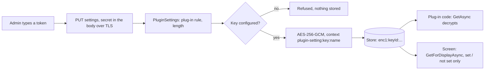

# Stage review: encrypted field values (beta row 4)

Decision and reasons: [Claude-decision-2026-11-encrypted-fields.md](../Claude-decision-2026-11-encrypted-fields.md).

## What was built

- `Adventures.Security/Encryption`: `IFieldEncryptor`, `AesGcmFieldEncryptor`, `FieldEncryptionOptions`, `AddFieldEncryption(configuration)`.
- `Adventures.MEF`: `PluginSettingKind.Secret`; `PluginSettings` encrypts secrets before storing, refuses with no key, keeps an empty secret field, clears on request; `GetForDisplayAsync` masks. New project edge `Adventures.MEF -> Adventures.Security` (recorded in the architecture guard).
- `PluginsController`: GET returns `secretsSet`; PUT accepts `clear`.
- Angular `adv-setting-fields`: password-style field (`autocomplete="new-password"`), "A value is set" / "Not set", Clear button; the Customize screen reloads after a save.
- App host: `AddFieldEncryption(builder.Configuration)`; dev key in user-secrets, `CurrentKeyId=dev1` in `appsettings.Development.json`.
- Also (human request this session): the hard-coded tag cloud under the Posts list is removed; the footer zone widget is the only one.

## Verified

Foundation: all suites pass (Security 59 including 15 cipher tests, Collaboration 21 including 8 secret-setting tests, architecture 23). App: HostTests 22, WebApi.Tests 55. Client admin project: 115 tests. Not seen in a browser; no production key exists yet.

## Threats and answers

- Store or export read: ciphertext only. Value moved to another setting: fails to decrypt. Tampering: GCM tag fails, value reads as not set. Wrong or lost key: reads as not set, never an exception, never logged. Browser read: never carries the value. No key: refused, never plain text.
- Open: the secret travels once from the browser to the API (TLS); the shared dev key in user-secrets is a dev value only.

## Try it

A plug-in that declares a `Secret` setting shows the field on **Admin > Plugins > Customize**. The sample plug-in does not declare one yet.
