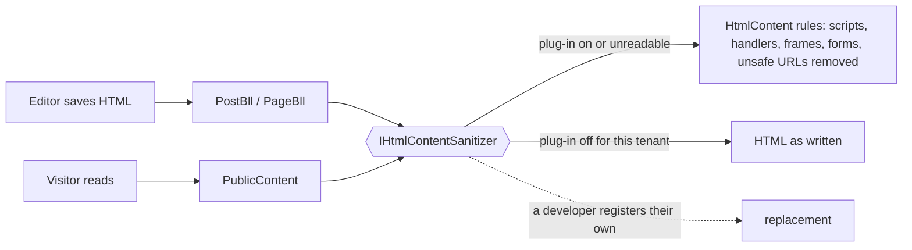

# Stage review: HTML sanitising is a default-on plug-in behind a seam (2026-11-21)

Beta scope map row 1, second stage (`Claude-beta-scope-2026-11.md`). Branch `claude-session-2026-11-29` in both repos. Decision it implements: `Claude-mcp-tool-inventory-2026-11.md`, "Decision on sanitising returned HTML" (human, 2026-11-20).

## What was built

| Piece | Where | Role |
|---|---|---|
| `IHtmlContentSanitizer` | `Adventures.Blog/Content/HtmlContentSanitizer.cs` | the seam: hands back the sanitising function for the request, so a host or developer can replace it (register another after `AddBlog()`) |
| `HtmlContentSanitizer`, `HtmlSanitizerPlugin` | same | the default: today's fixed rules while the `html-sanitizer` plug-in is on; HTML as written when it is off; any fault reading the switch falls on the safe side (sanitise) |
| `PostBll`, `PageBll`, `PublicContent`, `ContentFormats.Prepare` | `Adventures.Blog` | saving and serving go through the seam (optional constructor parameter: with none registered the fixed rules apply, as before) |
| `AddBlog()` | `BlogServiceCollectionExtensions` | registers the seam and declares the plug-in, so the Plugins page lists "HTML sanitising" with a switch |
| Warning on the Plugins page | `admin-plugins` (Angular) | a plain warning while sanitising is off |
| `Plugin` state is now per tenant | `AppEntityServices`, `Claude-tenant-scoped-types.json` | see the finding below |
| `LegacyModePlugins` | `AiBlogResearch.WebApi/Startup` | the legacy data mode's fixed plug-in switches (collaboration off), replacing a start-up step |

## Finding fixed in this stage (threat: one tenant weakening another)

The plug-in switches were stored in one graph shared by every tenant. With a sanitiser that can be switched off, an administrator of any tenant could have turned sanitising off for every tenant's readers. `Plugin` state is now a tenant-scoped type (registration, the relabel type list, and the host test that keeps the list equal to the registrations). The live store holds three old rows, all currently enabled, which is also the default, so nothing changes for the three existing plug-ins.
Consequence found by the tests: the legacy data mode used to write "off" for the collaboration plug-ins at start-up, which has no tenant; it now uses `LegacyModePlugins` and writes nothing.

## Who may switch it off

Switching a plug-in needs the `plugins.manage` right (a tenant administrator's), on that tenant only, with the warning shown. A separate stricter right for this one switch is not added; say so if you want one.

## Verified

- Tests first. Foundation: 5 seam tests (on, off, no plug-in state at all, unreadable switch, registration and replacement), 1 Bll test and 1 public-content test with the sanitiser off; architecture rule updated for the new Blog to MEF edge. App: 3 `LegacyModePlugins` tests; client: 3 warning tests (admin library 95 tests).
- Full Foundation and app suites pass; production client build 934.38 kB.

## Not built or not verified

- The Customize screen and a per-plug-in settings store (the allow-list: extra tags, attributes, URL schemes) are the next stage; this stage is the seam, the switch, the tenant fix and the warning.
- Not seen in a browser. No widget HTML goes through the seam yet (widgets are a later stage).
- Existing stored posts are unchanged; turning the switch off only affects what is saved and served afterwards.
