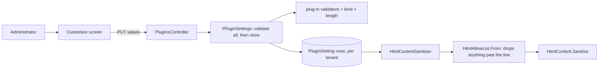

# Stage review: the Customize screen and per-plug-in settings (2026-11-21)

Beta scope map row 1, third stage (`Claude-beta-scope-2026-11.md`). Branch `claude-session-2026-11-30` in both repos. Decision it implements: "every plug-in gets a Customize screen for its own settings" (human, 2026-11-20), with the sanitiser allow-list as the first use.

## What was built

| Piece | Where | Role |
|---|---|---|
| `PluginSettingDefinition`, `PluginSettingKind` | `Adventures.MEF/Plugins/PluginSettings.cs` | a plug-in declares its settings (name, label, description, Text, Lines, Bool or Number, default, max length, its own validator) on its `PluginDefinition` |
| `IPluginSettings`, `PluginSettings`, `PluginSetting` | same, seed `seed-024-plugin-settings.nq` | stored one row per plug-in key and setting name; defaults until set; the whole save is validated first, so one bad value stores nothing; only declared settings are accepted |
| `GET/PUT api/plugins/{key}/settings` | `PluginsController` (right `plugins.manage`) | the Customize screen's API; 404 for an unknown plug-in, 409 with the plug-in's own reason for a refused value |
| `HtmlAllowList` and three settings | `Adventures.Blog/Content` | extra allowed tags, extra allowed attributes, allowed URL schemes for the sanitiser |
| Customize screen | `admin-plugin-customize` (Angular), route `/admin/plugins/:key` | a form built from the declared definitions, so a new plug-in gets its screen with no client change; a "Customize" link on the Plugins page for a plug-in that has settings |
| App wiring | `StartupSeeds`, `AppEntityServices` (tenant-scoped), `Claude-tenant-scoped-types.json`, `Program.cs` schema check | settings are per tenant like the plug-in switches |

## The line the allow-list cannot cross (threat: widening the list is the same as switching sanitising off)

Scripts, styles, objects, frames, meta, base, link, forms and their controls, svg and math cannot be allowed as tags; event-handler attributes (`on...`), `srcdoc`, `formaction`, `action` and `ping` cannot be allowed as attributes; only `http`, `https`, `mailto`, `tel`, `ftp` and `sms` can be allowed as URL schemes (never `javascript`, `data`, `vbscript` or `file`). This is enforced twice: when a value is saved (the plug-in's validator refuses it with the reason) and again when the list is built for use, so a value written some other way is ignored. If the settings cannot be read, today's fixed rules apply, never a looser list. An owner who needs more than this switches the plug-in off, which has its own warning.

## Verified

- Tests first. Foundation: 10 settings-store tests, 20 allow-list and sanitiser-settings tests, 6 controller tests; full Foundation suite passes. App: full suite passes (host tests boot the real host with the new tenant-scoped type). Client: 4 Customize screen tests and 2 link tests, admin library 101 tests; production build 939.87 kB.
- Not seen in a browser.

## Not verified or not built

- The per-tenant isolation of the new rows relies on the same tenant-scoped repository as the plug-in switches (guarded by the host test that keeps the type list equal to the registrations); there is no separate two-tenant live test.
- Initial bundle is 939.87 kB against a 1.00 MB error budget: about 60 kB of headroom is left, so the next client feature should lazy-load or trim before it adds more.
- The settings of discovered (directory) plug-ins use the same store, but no real DLL has been loaded outside the tests; the developer sample is the next stage and will prove it.
- Existing posts are not re-sanitised when the allow-list changes; the list applies to what is saved and served afterwards.
