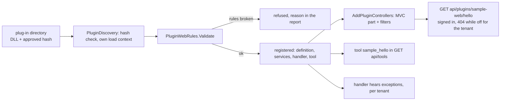

# Stage review: the developer sample, a plug-in with its own API, tool, setting and event handler (2026-11-21)

Beta scope map row 2 (`Claude-beta-scope-2026-11.md`), tool plan stage 4. Branch `claude-session-2026-12-02` in both repos. It proves, with a real DLL loaded by the real host, that a developer can extend the app without touching core code.

## What was built

| Piece | Where | Role |
|---|---|---|
| `Adventures.MEF.SampleWebPlugin` | `Adventures.Foundation/test` | the sample: an exported `IPluginModule` that registers a **controller** (`api/plugins/sample-web/hello`), a **tool** (`sample_hello`), a **setting** (Greeting, edited on the Customize screen) and an **event handler** (counts recorded exceptions) |
| `Adventures.MEF.WebApi` (new library) | `Adventures.Foundation/src` | `PluginWebRules` (the rules), `PluginEnabledFilter`, `PluginControllerConvention`, `AddPluginControllers` |
| `PluginValidator`, `PluginAssemblies` | `Adventures.MEF` | a host check run on each discovered plug-in before it is accepted; the accepted plug-ins' assemblies are remembered for MVC |
| Host wiring | `Program.cs`, `AppAssemblies` | validators passed to discovery, `AddPluginControllers()`; discovery now ignores assemblies outside the default load context |

## The rules (threat: a plug-in widening what it was approved to do)

Checked before any part of the plug-in is registered; a plug-in that breaks one is refused whole and the reasons are listed on the Plugins page and in the log:
1. **Every route is under `api/plugins/{key}/`** (case-insensitive), including absolute action routes: a plug-in cannot shadow or extend the host's own API or auth routes. A controller with no route is refused.
2. **Nothing is anonymous:** `[AllowAnonymous]` on a plug-in controller or action refuses the plug-in; each plug-in controller also gets an authenticated-caller filter.
3. **A plug-in endpoint answers 404 while the plug-in is off for the tenant** (the same switch as the rest).
4. **Every tool is tied to the plug-in and calls a route under its prefix:** a tool without the plug-in key would stay offered when the plug-in is off; a tool pointing at the host's API is refused. Tools must be registered as instances so they can be checked.

Not new but relied on: only a DLL whose SHA-256 is on the approved list loads, its private dependencies too, in its own load context.

## Found and fixed on the way

`AppDomain.GetAssemblies()` lists assemblies from every load context, so after the first plug-in loaded, a later host start in the same process (the tests; never production, which starts once) took the plug-in's assembly for a host library and registered it a second time or without the approved check. Host discovery now only considers the default load context. Caught by the host tests, which failed in the other test classes.

## Verified

- Tests first. `Adventures.MEF.WebApi.Tests`: 16 (each rule, the sample passes, the test assembly's deliberately bad controllers fail, the switch filter). `Adventures.MEF.Tests`: 2 for the validator hook and the accepted assemblies (33 in all). Host tests with the real DLL (21 in all, 4 new): an approved DLL brings its API (200 signed in, 401 anonymous), its tool (listed with the right path) and its setting default into the real host; switching it off for one tenant gives 404 and drops the tool there only; a recorded exception is heard by the handler while the plug-in is on and not while it is off; an unapproved DLL brings nothing and is reported.
- Full Foundation and app suites pass; the architecture guard records the new library and its two edges.

## Not built or not verified

- **The widget** half of the sample waits for the zone design (scope map row 3); this sample has no UI part, and no client code is loaded from a plug-in.
- **The Customize screen for the sample** works through the same code as the sanitiser's but was not clicked in a browser.
- **A plug-in cannot yet add its own admin screens or menu entries;** it adds API, tools, settings and handlers.
- **Hot reload:** a new DLL needs a site restart (startup-only loading, as decided).
- **Review of a real plug-in:** the approved list is the control; nothing yet helps review the DLL's code (the reviewed library idea, row 3).
- **Blog post:** a developer-facing "write your first plug-in" post now makes sense (the sample is the material); drafting it is the next small step if you want it.
