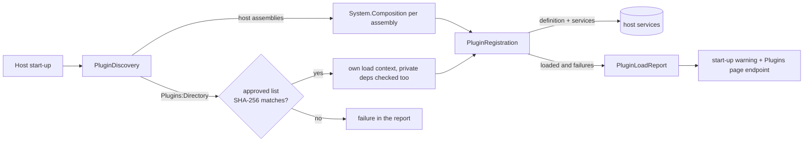

# Stage review: plug-in framework stage 1, discovery from projects and a DLL directory (2026-11-21)

Beta scope map row 1 (`Claude-beta-scope-2026-11.md`). Branch `claude-session-2026-11-28` in both repos (the Foundation holds the library, the app wires it). Committed, not merged or deployed.

## What was built

| Piece | Where | Role |
|---|---|---|
| `IPluginModule` | `Adventures.Foundation/src/Adventures.MEF/Discovery` | what a developer exports: a `PluginDefinition` and `ConfigureServices` |
| `PluginDiscovery`, `PluginDirectoryOptions` | same | finds exported modules (System.Composition, the lightweight MEF) in the host's assemblies and a plug-in directory |
| `PluginRegistration.AddPluginDiscovery`, `PluginLoadReport` | same | registers each plug-in (definition and services) and keeps a report of what loaded and what failed |
| `PluginsController` `GET api/plugins/load-report` | `Adventures.Collaboration.WebApi` | the report for administrators (right `plugins.manage`) |
| Host wiring | `AiBlogResearch.WebApi/Program.cs`, `Startup/AppAssemblies.cs` | runs discovery at start-up, logs one warning per refusal |
| Sample plug-in | `test/Adventures.MEF.SamplePlugin` | the shape of a developer's plug-in; the tests copy its DLL into a temporary plug-in directory |

## Threats addressed (a DLL is code that runs with the host's rights)

- **An unreviewed or swapped DLL:** with approval on (the default), only files named in `approved-plugins.json` with a matching SHA-256 load. The bytes are read once and the hashed bytes are what is loaded, so the file cannot be swapped between check and load. A missing, empty or malformed list loads nothing and says so.
- **A plug-in's private dependencies** are loaded through the same check, so a dependency cannot be swapped either. A plug-in cannot replace a host assembly: anything the host already has comes from the host.
- **One bad plug-in:** each assembly is composed on its own; a file that is not an assembly, a duplicate key, or a module that throws while configuring is reported and the rest still load. A module that throws adds nothing to the services.
- **Silent skipping:** every refusal is a `PluginLoadFailure` (source and reason), logged as a start-up warning and available at `GET api/plugins/load-report`.
- Off by default: with no `Plugins:Directory` setting nothing outside the host's own libraries is scanned.

## Verified

- Tests first: 16 in `Adventures.MEF.Tests` (host assembly, approved DLL, not listed, tampered, no list, malformed list, approval off, bad file, duplicate key, missing directory, top-level only, registration, report, faulty configure), 3 in `Adventures.Collaboration.WebApi.Tests` (report content, empty report, right and no anonymous access), 1 host test (the real host composes its own libraries with no failure and no plug-in).
- Full Foundation and app suites pass, including the architecture guard with the two new projects.
- Found while running the suites (rule 14): `AiTriageTests.TheHourlyCap_StopsFurtherCalls` failed once, because two test classes share a static call counter and xUnit ran them in parallel; fixed in its own commit (both classes share one collection) and three full runs pass.

## Not verified or not built yet

- No plug-in directory exists on any host, and no real plug-in DLL has been loaded outside the tests; the first live use comes with the developer sample.
- A plug-in cannot yet add controllers (needs MVC application parts) or widgets; stage 2 and 3 of the plan.
- Stage 1c (same day): the Plugins screen now shows what discovery loaded and what it refused (service call, two sections, a failing report request still lists the plug-ins; 4 new client tests, admin library 92 tests pass, production build 933.68 kB). Not seen in a browser.
- The Customize screen is NOT built yet, on purpose: a settings store needs its own schema, seed, tenant registration and guard entries, and the first plug-in that needs settings is the HTML sanitiser, so the store is designed with that first real setting instead of as unused plumbing.
- No blog post: a developer-facing post fits once the developer sample works end to end.

## Next

The sanitising plug-in (default on) with its Customize screen and a per-tenant settings store, designed against that first real setting.
