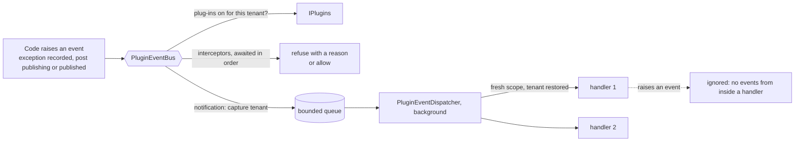

# Stage review: the in-process event bus for plug-ins (2026-11-21)

Beta scope map row 1b (`Claude-beta-scope-2026-11.md`); design in the backlog, "Widgets and plug-ins through MEF", item 9. Branch `claude-session-2026-12-01` in both repos. Motivation (human): BlogEngine.NET's event hooks let an extension tap in without touching core code; for example a plug-in that sends every recorded exception to a Slack channel.

## What was built

| Piece | Where | Role |
|---|---|---|
| `IPluginEvent`, `IPluginEventHandler<T>`, `IPluginEventInterceptor<T>`, `InterceptResult`, `IPluginEvents` | `Adventures.MEF/Events/PluginEvents.cs` | the contracts: **notifications** (after the fact, off the request) and **interceptors** (before an action, may refuse with a reason) |
| `PluginEventBus` | `Adventures.MEF/Events/PluginEventBus.cs` | raises events; keeps only the handlers of plug-ins that are on for this tenant; never throws, never waits for a plug-in |
| `PluginEventDispatcher` (hosted service) and a bounded queue | same | delivers notifications in a fresh scope: each handler isolated, timed out, in registration order |
| `AddPluginEvents`, `AddPluginEventHandler<TEvent,THandler>(pluginKey)`, `AddPluginEventInterceptor` | same | a plug-in registers its handlers from its `IPluginModule.ConfigureServices`, so discovery already finds them |
| `ExceptionRecordedEvent` | raised by `ExceptionLogBll` after the entry is stored | message scrubbed of secrets (`Redactor`) and shortened to 500 characters; plain values only |
| `PostPublishingEvent` (interceptor) and `PostPublishedEvent` | raised by `PostBll` | a plug-in may refuse a publish (the post stays a draft and the person sees the reason), and is told after a publish |
| `RequestTenantEventContext` | `Adventures.WebApi/Tenancy` | captures the tenant of the request that raised the event and restores it in the delivery scope |
| Host wiring | `Program.cs` (`AddPluginEvents`, the tenant context) | |

## Threats and failure modes addressed

- **A slow or hanging plug-in slowing the site:** notifications are queued and delivered off the request; a request never waits for them. Each handler has a timeout (30 s) after which it is given up on (the abandoned task is not cancelled if it ignores its token).
- **A failing plug-in:** every handler is wrapped; a throw or a timeout is logged as a warning naming the handler and plug-in, and the next handler still runs.
- **A plug-in that triggers itself** (a Slack handler fails, the failure is recorded as an exception, which would call Slack again): an event raised from inside a handler or interceptor is ignored.
- **Flooding:** the queue is bounded (1000); when full, new events are dropped and a warning is logged; a request is never blocked.
- **A plug-in that is off for a tenant** gets nothing for that tenant: the check uses the tenant-scoped switches at raise time. If the switches cannot be read, no plug-in code runs (unknown means off).
- **Secrets and internals leaking to plug-ins:** events hold plain values only, never an exception object; the exception message is scrubbed and shortened. A test keeps exception objects out of the well-known events.
- **A buggy interceptor locking the site:** an interceptor that throws or times out (5 s) is logged and counts as allowing. This is a choice: a plug-in meant to be a hard gate cannot fail closed yet. Say so if you want fail-closed for some interceptors.

## Verified

- Tests first. `Adventures.MEF.Tests`: 15 bus tests (delivery with the tenant, plug-in off, no waiting on a slow handler, throwing handler, hanging handler, no event from inside a handler, order, nothing captured for an unheard event, full queue, interceptors: none, refusing chain, off plug-in, broken or slow, context restored, plain-value events), stable over five runs. `Adventures.Entities.Tests`: 5 exception event tests. `Adventures.Blog.Tests`: 3 publish event tests. `Adventures.WebApi.Tests`: 3 tenant context tests. Host test: a recorded exception reaches a plug-in handler through the real host, within seconds.
- Full Foundation and app suites pass; the architecture guard records the two new edges (Entities.Diagnostics and WebApi to MEF).

## Not built or not verified

- No real plug-in uses it yet and no Slack plug-in exists: the developer sample (next stage) adds a handler, off by default. A Slack webhook address is a credential, so a real Slack plug-in waits for encrypted field values (beta row 4).
- Events fire only in the process where they happen: the API raises exception and post events; the MCP server's own events are not raised yet.
- Comment, sign-in and tool-called events from the plan are not raised yet (only exception recorded and post publishing and published); each is a small addition.
- The queue is in memory: events queued when the site restarts are lost, which suits notifications and not guaranteed delivery.
