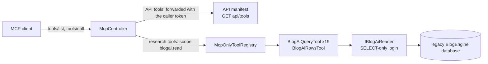

# Stage review: tool plan stage 3, the research tools are MCP-only and read-only by construction (2026-11-21)

Branch `claude-session-2026-11-27` (app repo only; the Foundation did not change). Committed, not merged or deployed.

## What was built

The 20 `blogai_*` research tools now implement a small contract, `IMcpOnlyTool`, and live in their own `McpOnlyToolRegistry`, apart from the tools the API's manifest describes. `McpController` no longer knows how any research tool works: it lists the registry's tools for the scopes the caller holds and calls the one named.

| Piece | Where | Role |
|---|---|---|
| `IMcpOnlyTool`, `McpToolOutcome`, `McpOnlyToolRegistry` | `src/McpServer.WebApi/Tools/McpOnlyTool.cs` | the contract and the list; the registry refuses a duplicate name and a tool with no scope |
| `ResearchTools`, `BlogAiQueryTool`, `BlogAiRowsTool` | `src/McpServer.WebApi/Tools/ResearchTools.cs` | the 19 catalogue queries and the paged table reader, behaviour unchanged (moved out of the controller) |
| `McpController` | `src/McpServer.WebApi/Controllers/McpController.cs` | 384 lines down to about 270; takes the registry instead of the legacy reader |
| `Program.cs` | `src/McpServer.WebApi/Program.cs` | registers the registry over the one reader |

## Why it is read-only now, not just by habit (threat: a future research tool that writes)

Finding addressed: inventory gap 6, "nothing stops a future one from writing". Guard tests in `test/McpServer.WebApi.Tests/Controllers/McpOnlyToolGuardTests.cs` fail if:

1. an `IMcpOnlyTool` is built from anything but the legacy reader and its query (an HTTP client, the API client, a store or the configuration could write);
2. `IBlogAiReader` gains any method besides `RunAsync` and `ReadRowsAsync`;
3. the MCP project gains any project reference beyond Security, Security.AspNetCore, WebApi and ServiceDefaults, or any package beyond SqlClient and Pkcs (so no store project can creep in);
4. the registry holds a duplicate name or a tool with no scope; every tool must need `blogai.read` and say "Read-only.".

Behaviour tests also cover each tool: arguments reach the reader, not configured is reported, a bad argument shows its message, and the rows tool refuses any table not on the list. The existing SELECT-only and secret-column tests on the catalogue stay.

## Verified

- Tests written first (they did not compile before the contract existed); then the build, then `dotnet test AiBlogResearch.slnx`: every project passes (McpServer.WebApi.Tests 105, host tests 15, API tests 52, all Foundation projects).
- `tools/list` for a `blogai.read` token returns the same 20 tools in the same order, and a token without the scope sees none and is refused as a tool error (the existing integration tests, unchanged, still pass).

## Not verified

- Not run against the live legacy database or deployed; the wire behaviour is unchanged by construction and by the integration tests, but a live `tools/call` after the MCP deploy is the real proof.

## Next in the plan

- Stage 4 (developer sample): one widget and one tool in a separate project discovered through MEF; it shares work with the widget and zone design, so it waits for that plan. The registry is ready for a developer's own MCP-only tool (add an `IMcpOnlyTool` to the list) but nothing discovers one yet.
- Blog post: none written. This is an internal refactor whose guard tests and this review explain it; a post would fit better once the developer sample shows how to add a tool from outside.
