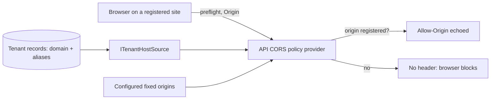

# Stage review: T4a, the API answers the sites an administrator registered

Found 2026-11-21 when the human click-tested the temporary address `http://billkrat-001-site1.atempurl.com/login`: the page loads, sign-in fails, because the browser preflight got no `Access-Control-Allow-Origin` (the allowed origins were only `https://<domain>` and `https://www.<domain>`).

## What was built

- `ITenantHostSource` / `TenantHostSource` (`Adventures.Entities.Identity`): every tenant's domain and aliases, read from the Tenant records (the same names the resolver matches).
- `TenantCorsPolicyProvider` + `AddTenantCors(policyName, fixedOrigins)` (`Adventures.WebApi/Tenancy`): the CORS policy is built from data. Allowed: each registered name over `https`, its `www.` host, and, for a host's temporary address (`.atempurl.com`, `.dtempurl.com`), also over `http`; plus the fixed origins from configuration (development, existing installs). Kept 60 s; if the store cannot be read only the fixed origins apply.
- App: `AppPlatformServices` uses `AddTenantCors`; `AppEntityServices` registers the host source.

## Threats and answers

- Wildcard or look-alike (`example.com.evil.test`, `evilexample.com`, `*`, `null`, other ports, other schemes): refused (tests).
- Plain http for a real domain: refused; only a temporary host address gets http (that site has no certificate until a domain is attached).
- A malformed registered value (path, wildcard, spaces, port) is ignored, never turned into a trusted origin.
- Store down: fail closed to the fixed origins, never an exception.
- No cookies (`SupportsCredentials` false); an allowed origin grants a browser permission to call the API, nothing more. **The tenant of a request is still decided only by the host the server saw** (T1's rule is unchanged); signed-in work is still decided by the token's tenant claim.

## Verified

Foundation: 12 provider tests, whole solution passes. App: 6 real-pipeline preflight tests (registered domain, www, temporary alias echoed; evil, http real domain, look-alike refused), host tests 28, API tests 55. Not tried against production or in a browser.

## To use it

Register the temporary address as an alias on the tenant (Admin > Tenants, host names), wait up to a minute, then sign in from `http://billkrat-001-site1.atempurl.com`. That page calls the API at `api.<domain>`, so it shows that tenant's data (the tenant follows the API's host).

## Not done (rest of T4)

Adding the temporary address as an alias automatically at first run; a tenant on its own domain with its own API choice (the Origin-selects-public-tenant design in the backlog, which does narrow T1 and needs its own threat tests); a new tenant on a domain; the working default before any domain exists; per-tenant sharing settings.
