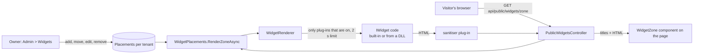

# Stage review: widgets and the four zones (2026-11-21)

Beta scope map row 3 (`Claude-beta-scope-2026-11.md`), the visible half of the plug-in lock. Branch `claude-session-2026-12-03` in both repos. Source of the wish list: backlog, "Widgets and plug-ins through MEF", items 0 to 5. The design decisions below were mine (the human's rule: an unanswered recommendation is delegated); each can be changed.

## What was built

| Piece | Where | Role |
|---|---|---|
| `IWidget`, `WidgetDefinition`, `WidgetContext`, `WidgetZones`, `AddWidget<T>(pluginKey, definition)` | `Adventures.MEF/Widgets` | the contract: a widget is a class that returns HTML for a zone; what it is (key, title, settings) is data, like a tool |
| `WidgetRenderer` | `Adventures.Blog/Widgets` | what the host allows: only widgets of plug-ins that are on, only the four zones, declared settings with defaults, a 2 s limit, the HTML through the **sanitiser plug-in**, a 100,000-character cap; a widget that fails, hangs or answers too much is left out and logged |
| `WidgetPlacements`, `WidgetPlacement`, seed 025 | `Adventures.Blog/Widgets` | where each widget sits: one row per placement (zone, widget, title, settings, position), per tenant; add, change, remove, move, render a zone |
| `WidgetsController` (`api/widgets`, site-settings right) and `PublicWidgetsController` (`api/public/widgets/{zone}`, anonymous) | `Adventures.Blog.WebApi` | the Widgets screen's API and the public read of a rendered zone |
| Built-ins: text box, tag cloud, category list | `Adventures.Blog/Widgets/BuiltInWidgets.cs` | under a built-in **Widgets** plug-in (switch it off to hide them all); names are HTML-encoded in text and URL-encoded in addresses |
| Plug-in widget rules | `Adventures.MEF.WebApi` | a plug-in's widget key must start with `{plug-in key}.` and be owned by that plug-in, so it cannot shadow another widget and goes with its switch |
| `WidgetZone` component | `blog-reader` | shows a zone's widgets on the public page; an empty or failing zone draws nothing; links to this site navigate inside the app |
| Public layout | `app.html`, `app.scss` | header zone above the content, left and right beside it, footer below; none in the admin area; **a phone shows only header and footer** |
| Widgets admin screen and `SettingFields` | `admin` library | the four zones with their widgets; add, move up or down, edit title and the widget's own settings, remove; a placement whose plug-in is off is marked and keeps its place; the settings form is now shared with the Customize screen |
| Sample plug-in widget | `Adventures.MEF.SampleWebPlugin` | `sample-web.note`, placed and shown through the real host in a test |

## Decisions (mine, to confirm or change)

1. **Server-rendered HTML, no Angular per widget.** A widget returns HTML; a C# developer needs no Angular (the human's idea 0). Angular-module widgets are not built.
2. **The sanitiser plug-in applies to widget HTML** like post HTML (the human's decision of 2026-11-20): on by default; an owner who switched it off is trusted for widgets too, and the page then shows the HTML as given.
3. **Settings per placement, not per widget:** two text boxes can differ. The settings form comes from the widget's declaration.
4. **Up and down buttons, not drag and drop** in this slice (BlogEngine used drag); the layout storage does not change if drag is added later.
5. **Right needed:** the site-settings right (the layout is a site setting); no new right, so no role migration.
6. **The existing hard-wired tag cloud** in the Posts page footer is untouched, so nothing disappears from the live site; the new tag cloud *widget* is a separate, optional one. Retire the hard-wired one when the owner has placed the widget.
7. **Built-in widgets sit under one plug-in (`widgets`)** so the Plugins page can switch them all off; plug-in widgets sit under their own plug-in.

## Threats and failure modes addressed

- **A widget breaking or slowing the page:** isolated per widget, 2 s limit, left out and logged; the zone and the page still render. The public read is anonymous but returns only rendered output.
- **Script in widget HTML:** passes through the sanitiser plug-in (tested on and off); the built-ins encode names; links in widgets that point at this site navigate in-app, others are left to the browser.
- **A plug-in widget shadowing a built-in or another plug-in's widget:** refused by the key rule before the plug-in loads.
- **One tenant seeing or changing another's layout:** placements are a tenant-scoped type (registration, relabel list, and the host test that keeps the list equal to the registrations); the real-DLL host test shows a placement is visible for one tenant only.
- **A placement outliving its plug-in:** kept but marked and not shown; shown again when the plug-in is switched on; removable.

## Verified

- Tests first. Foundation: 8 renderer, 12 placement, 7 built-in, 7 controller, 5 widget-key and zone tests (Blog 198, Blog.WebApi 43, MEF.WebApi 21); a real-DLL host test places a plug-in widget and reads the public zone per tenant and while the plug-in is on or off (host tests 22). Client: `WidgetZone` 5, Widgets screen 6 (admin 107, blog-reader 37, app 36, all projects 325).
- Full Foundation and app suites pass; the architecture guard caught a duplicate public type name, fixed.
- Production client build 952.14 kB (error limit 1.00 MB, so about 48 kB of headroom remains).

## Not built or not verified

- **Not seen in a browser**, including the layout (the flex columns and the phone rule are CSS only). Please look at the public page on a wide window and a narrow one, and open Admin > Widgets.
- **Drag and drop, Angular-module widgets, the reviewed upload library, and most of BlogEngine's list** (author list, month list, search, newsletter and others) are not built; the contract makes each a small addition.
- **Four requests per public page view** (one per zone), uncached; one request for all zones or a short cache is the first optimisation if the load shows up.
- **A widget's settings are stored in clear text**, like plug-in settings; credentials wait for encrypted fields.
- **The Widgets screen has no widget preview**; the public page is the preview.
