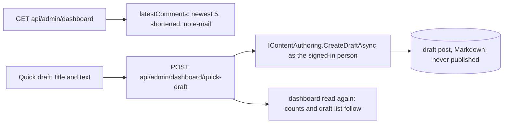

# Stage review: Dashboard Quick draft and Latest comments (beta row 12, parity stage 3), 2026-11-22

The two BlogEngine dashboard parts ours lacked: a Quick draft box and a Latest comments list.

## What was built
- **Latest comments:** the dashboard model carries the newest five visitor comments (author, post title, state, date, a 140-character excerpt with whitespace collapsed); the card links to Admin > Comments. The e-mail address is never sent (a test pins it).
- **Quick draft:** `POST api/admin/dashboard/quick-draft` (`QuickDraftController`, needs the right to write a post) creates a DRAFT post of the signed-in person through the same authoring service Claude uses: Markdown, never published, title 1 to 200 characters, text up to 20,000 (longer posts use the editor). No signed-in name means nothing is created. The box links to the new draft and the dashboard reads itself again so the counts and the draft list follow.
- **Tests:** server (latest comments 3, quick draft 7 including the right and no publish route), client (4 new specs). Every suite and both builds pass.

## Not done
- The stats already link to the Posts and Pages lists; links to filtered lists (published or draft only) need list filters the generic grid does not have yet (small, later).
- Not seen in a browser; the Quick draft box has no rich editor on purpose (a quick note).

## Test steps
1. Dashboard: type a title and some text in Quick draft, Save: a link to the draft appears and Draft posts grows.
2. Post a comment on a post as a visitor: it shows under Latest comments with its state.
