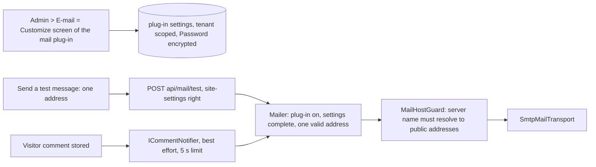

# Stage review: the E-mail screen with test-send (beta row 12, parity stage 2), 2026-11-22

BlogEngine's Settings > E-mail (address, user, password, server, port, subject prefix, SSL, "send comment e-mail", "Test mail settings"), built as a plug-in so it reuses the Customize screen and the encrypted secret field.

## What was built
- **The `mail` plug-in** (Adventures.Blog, on the Plugins page and under System > E-mail): Sender address, Mail server, Port, User name, Password (a Secret: encrypted at rest, write-only, Clear), Use SSL (on), Subject prefix, Tell me about new comments (off). Each value is validated when saved: one plain address (no line break, list or display name), a bare host name (no port, scheme or spaces), a port from 25, 465, 587, 2525 only, a one-line prefix.
- **Test message:** `POST api/mail/test` (needs the site-settings right) sends one plain-text message to the address typed, using the SAVED settings. The Customize screen of the mail plug-in has a "Send a test message" box. A failure says what is missing or the SMTP status, never the password or the server's own text.
- **New-comment notice:** when switched on and the settings are complete, the sender address gets a note (author, post, excerpt, where to approve). It is best effort with a 5 second limit; a slow or failing mail server never delays or fails the visitor's comment. Visitor text is stripped of line breaks before it can reach a subject.
- **Threats addressed:** header injection (every address, prefix and subject is one line, tested); the test button as a way to probe the server's network (port allow-list and `MailHostGuard` refuses loopback, private, link-local, carrier-grade and non-public addresses; `Mail:AllowPrivateHosts` is the operator's switch for a private relay); secret handling (encrypted field, never in a message, an error or a browser).
- **Tests:** Foundation 33 mail cases plus 3 comment-notice cases, 3 controller cases, 3 client specs; every suite and both builds pass.

## Not done
- Transport is `System.Net.Mail.SmtpClient`: STARTTLS on 587 works, implicit TLS on 465 may not (a MailKit transport can replace it behind `IMailTransport`). Not tried against a real server; the SmarterASP mail settings are the first real check.
- The encryption key must exist in production (already a human step) or saving the password is refused.
- No other mail uses (password reset, receipts) yet.

## Test steps
1. Admin > System > E-mail: fill the sender address, server, port 587, user and password, Use SSL on, Save. Reopen: the password is blank with "A value is set".
2. Type your address in the test box and Send: a message arrives with your prefix. Try with a wrong password: a plain failure, no password shown.
3. Port 22 or a server name with a port or http:// is refused on Save. A server that resolves to 127.0.0.1 is refused on test.
4. Turn on "Tell me about new comments", post a visitor comment: a note arrives; with the server wrong, the comment is still accepted.
