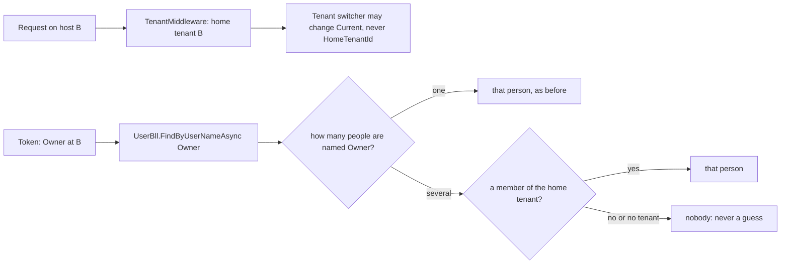

# Stage review: onboarding stage 1, user names per tenant (2026-11-22)

First of the four stages in `Claude-decision-2026-11-tenant-onboarding.md`: every tenant can have its own Admin.

## What was found
- **The sign-in account was already per tenant:** `AuthController` signs in against the tenant of the host (`SiteDomain.Tenant`), `UserAccountService.LoginAsync` looks the account up by tenant and user name, and the Users screen's Set password provisions per tenant. A spec already pins the tenant passed to the lookup. So two tenants can each hold a sign-in called Owner today.
- **The gap was the person behind the sign-in:** the people records (rights, profile, the tenant switcher) were found by user name alone, and creating a person refused a name used anywhere in the system. With two Owners the first match would have been used for the other tenant's sign-in.

## What was built
- `UserBll.FindByUserNameAsync`: one person of the name, that person (nothing changes for today's data); several, the one who is a member of the **home tenant** (the tenant of the host the request came on); none of them, or no tenant to decide by, nobody. Every caller (rights, profile, authoring, collaboration, the switcher) gets this without a change.
- `IHomeTenant` (set by the tenancy middleware, **not** replaced when the person switches to act in another tenant, so a platform administrator acting in B is still looked up as themselves).
- `CreateInTenantAsync`: the tenant people screen checks the name only among that tenant's people (ignoring case) and adds the person as a member. The system-wide `CreateAsync` keeps the old rule for tools and seeds.
- **Tests:** 8 for the person rules (two tenants each with an Owner, uniqueness inside one tenant, global create unchanged, the right person per tenant, nobody picked when ambiguous, one person as before, a person of two tenants, the people screen), 2 for the home tenant. Foundation, API, host and MCP suites pass.

## Not done in this stage (next stages)
- A fresh install still seeds our own tenants (stage 2) and there is no setup page (stage 3).
- A sign-in on a host with no tenant is not allowed yet for platform administrators (stage 3).

## Test steps
See the ledger, A12.
