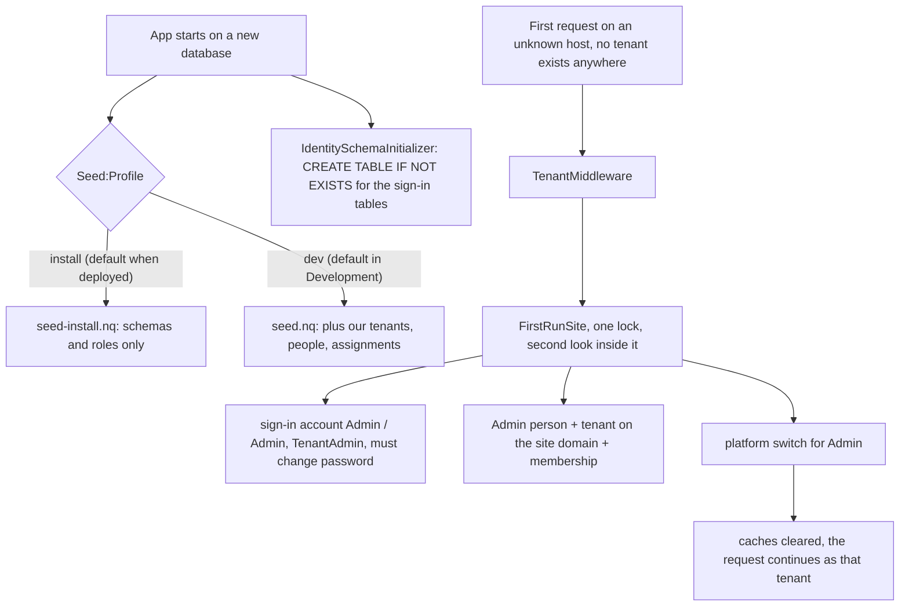

# Stage review: onboarding stage 2, the empty-store first site and the install seed (2026-11-22)

Second of the four stages in `Claude-decision-2026-11-tenant-onboarding.md`: a fresh install opens and signs in with `Admin/Admin` with nothing configured.

## What was built
- **`seed-install.nq`:** the baseline seed minus our tenants, people, blogs, organisations and their assignments (72 of 123 lines kept: the User schema and the roles). A test pins it to be exactly `seed.nq` minus those subjects, so the two cannot drift. **`Seed:Profile`** (`dev` or `install`) picks which one a NEW store gets; unset, Development keeps today's full seed and anything deployed gets the install seed. A store that already has the baseline is untouched either way (a seed applies once, by name), so our own production and development databases do not change.
- **The sign-in tables are made by the app:** `IdentitySchemaInitializer` runs the same `CREATE ... IF NOT EXISTS` statements as `Sql/schema.sql` and `schema-users.sql` (a test keeps them equal and proves none can delete or change data) on every start; a host without the right to create tables logs it and carries on. Before this the tables were made by a script run by hand.
- **`IAccountCreator`:** creates the Admin sign-in with the chosen first password (hashed), the all-rights sign-in role and the force-change flag; never touches an existing account, so a rerun cannot reset a password; per tenant.
- **`FirstRunSite` and the middleware step:** when a request comes on a host that reaches no tenant and the store holds no tenant at all, the host's site domain becomes the first tenant: the account first (safe to repeat), then the Admin person, the tenant, the membership and the platform switch. One process-wide lock plus a second look inside it means simultaneous first requests make one site. The domain drops a leading `api.`, `www.` or `mcp.` (the API lives on a subdomain of the site) when a real domain remains; a temporary address or `shop.foo.com` is kept. Only a real host name qualifies (never `localhost`, an address or a name with no dot). It runs whether tenancy enforcement is on or off.
- **A host without a sign-in store** (the Legacy developer mode) registers a no-op, so nothing changes there.
- **Tests:** install seed (4), seed profile (9), identity schema (4), account creator (4+), first site (the empty store, a populated store, junk hosts, simultaneity, a second host, the domain rule), middleware (6), no-op (1). Foundation, API, host and MCP suites pass.

## What is not done and not verified (honest list)
- **Not run end to end on a real empty database.** Everything above is proven with fakes and in-memory stores. The first real proof is a fresh Postgres database, `Seed:Profile=install`, then the first request: that is the first regression step below.
- **A temporary address has no `api.` host that reaches the same tenant.** SmarterASP gives the site and the API each their own temporary address (different names), so the site's temporary address works only if the API's own temporary host is also bound to the tenant. The setup page (stage 3) and the alias step cover attaching it; the simplest install is a real domain with `api.` and `www.` bindings. This is the open question already in the backlog; it is now visible, not solved.
- A later unknown host is still refused (stage 3 adds the setup page and the attach or new choice).
- A first-run site on `localhost` is not created (a developer uses the dev seed).

## Test steps
See the ledger, A12.
