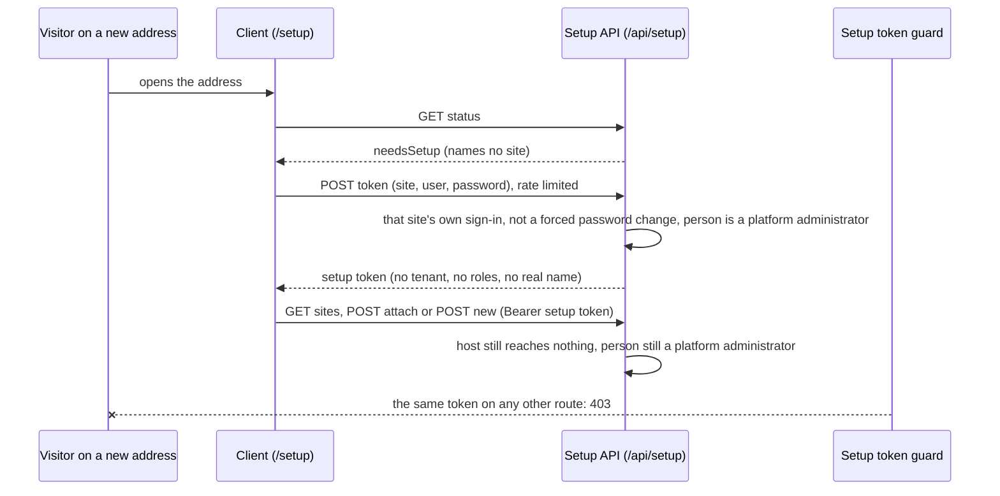

# Stage review: onboarding stage 3, the setup page for an unattached address (2026-11-22)

Decided with the human the same day (`Claude-decision-2026-11-tenant-onboarding.md`): the first host of an empty store becomes the first site (stage 2); any later host that reaches no site is never created silently. It shows a setup page, and a platform administrator of an existing site attaches the address to a site (an alias) or starts a new site on it.

## What was built
- **`SetupController`** (`Adventures.Identity.WebApi`): `GET status` and `POST token` are anonymous (the sign-in is rate limited like every token endpoint, and every failure is the same 401: wrong password, not a platform administrator, unknown site, unknown person); `GET sites`, `POST attach`, `POST new` need the setup token. Each call checks again that the host still reaches no tenant (404 otherwise) and that the person is still a platform administrator (403 otherwise).
- **Setup token:** claims `adv_setup` and `adv_setup_person`, the name `setup-session`, no tenant claim and no roles. **`SetupTokenGuardMiddleware`** (after authentication) answers 403 to it on every path except `/api/setup`, so a platform administrator of site A cannot use it on site B, where a name-based rights lookup could otherwise find B's Admin.
- **Tenancy:** `/api/setup` (and under it) is exempt from the unknown-host refusal; a neighbour such as `/api/setupx` is not.
- **`ISiteProvisioner`** extracted from the first-run code: account, person, tenant and membership, with a check before anything is written that no tenant already reaches the name. `FirstRunSite` now uses it; the setup page starts a new site through it (its own Admin with the default password, changed at the first sign-in, and the setup person is not made its administrator).
- **Single-site mode:** client routes are now answered early, before tenancy (GET and HEAD, no extension, not under `/api`, not a health probe), so an unknown address can load `/setup` even when enforcement is on.
- **Client:** `SetupService`, the `/setup` page (sign in, then attach to a site or start a new one), every text a label key, buttons with icons. The app asks `status` on start and sends an unattached address to `/setup`. The auth interceptor leaves a request that carries its own `Authorization` alone.

## Threats addressed
- Anyone adding an address to a site: needs a platform administrator's own sign-in.
- A setup token used elsewhere: refused by the guard on every other route.
- Listing sites before signing in: the status answer names none.
- Password guessing through the new sign-in: rate limited, a single answer for every failure.
- A forced-change default password counting as proof: refused until it is changed on the site itself.

## Verified
- Foundation: 9 guard tests, 20 controller tests (including the anonymous-action list and the rate-limit attribute), two tenancy exemption tests; Identity.WebApi 136, WebApi 187 pass. Host 46, API 77 pass. Admin client 158 pass.

## Not verified
- Never run against a real second host: the whole flow (new address, sign in, attach, then the address works) needs the human's run (see the ledger, A14).
- The setup token lifetime is the normal token lifetime; it is useless outside the setup API but is not shortened.
- The status call runs on every page load of every site (cheap: one resolver call, cached).

## Test steps
See the ledger, A14.
