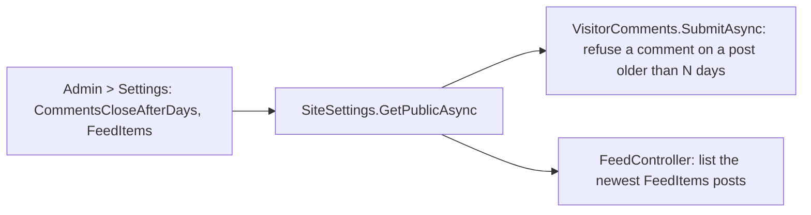

# Stage review: parity stage 1, settings that change behaviour (beta row 12), 2026-11-22

The first stage the admin parity matrix proposed (Settings Basic, Feed and Comments), cut to the settings that change what the site does, so none is a switch that does nothing.

## What was built
- **`CommentsCloseAfterDays`** (default 0 = never; 0 to 3650): the public comment form refuses a comment on a post published more than N days ago, with a message that names the limit. A post whose date cannot be read is never closed by the limit; a typo in the setting means never.
- **`FeedItems`** (default 20; 1 to 100): the RSS feed lists that many of the newest posts. An unset, zero or non-numeric value is 20.
- **`CommentsModerate`** (default true; the human decided 2026-11-22 that moderation may be switched off): false publishes a new visitor comment at once. Fail-safe: only the exact text false turns moderation off, so a typo never publishes unreviewed text. Everything else still applies when it is off (name and length limits, closing after N days, per-post switch, the honeypot and the rate limit, plain-text storage and display); the pending-queue cap only matters while moderating. The answer to the visitor and the hint under the form no longer promise a review when none will happen. Risk to know: with moderation off, anyone can publish text on the site; only for a blog whose visitors you trust, and an administrator can still unapprove or delete afterwards.
- All three are created for a tenant that lacks them, like the other known settings, so they appear on the Settings screen with no client change.
- **Tests:** comment limit (3), moderation off (3 store, 7 parsing, 1 truthful answer, 2 client), setting parsing (12 cases), feed size (1); the settings count in the existing tests is now ten. Foundation suite, app API and host suites pass.

## Deliberately not done from the matrix (and why)
- **Trust authenticated authors:** nobody but administrators sign in, and they do not comment through the public form, so it has nothing to act on.
- **Add date to post links, Only show description of posts, feed author and full text, Atom:** they change addresses or output formats (the old BlogEngine addresses already redirect); after beta unless you want them.
- **Timezone and date format:** dates are ISO by choice; the legacy time zone setting exists for the migration.
- **Language:** done in row 13.

## Questions for the human
1. (Answered: moderation may be switched off.)
2. Is a feed with full post text wanted at beta?

## Test steps
1. Admin > Settings: set CommentsCloseAfterDays to 30; a post older than that shows the form but refuses a comment with the limit message.
2. Set FeedItems to 5 and open the feed: five items.
3. Set CommentsModerate to false, post a comment on a post: it shows at once and the page says so; set it back to true.
