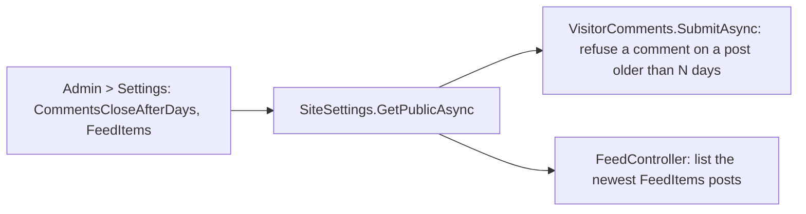

# Stage review: parity stage 1, settings that change behaviour (beta row 12), 2026-11-22

The first stage the admin parity matrix proposed (Settings Basic, Feed and Comments), cut to the settings that change what the site does, so none is a switch that does nothing.

## What was built
- **`CommentsCloseAfterDays`** (default 0 = never; 0 to 3650): the public comment form refuses a comment on a post published more than N days ago, with a message that names the limit. A post whose date cannot be read is never closed by the limit; a typo in the setting means never.
- **`FeedItems`** (default 20; 1 to 100): the RSS feed lists that many of the newest posts. An unset, zero or non-numeric value is 20.
- Both are created for a tenant that lacks them, like the other known settings, so they appear on the Settings screen with no client change.
- **Tests:** comment limit (3), setting parsing (12 cases), feed size (1); the settings count in the existing tests is now nine. Foundation suite, app API and host suites pass.

## Deliberately not done from the matrix (and why)
- **Moderate comments on/off and Trust authenticated authors:** switching moderation off lets an anonymous endpoint publish unreviewed text; that is a security-relevant decision for you, not a default. Filed as a question.
- **Add date to post links, Only show description of posts, feed author and full text, Atom:** they change addresses or output formats (the old BlogEngine addresses already redirect); after beta unless you want them.
- **Timezone and date format:** dates are ISO by choice; the legacy time zone setting exists for the migration.
- **Language:** done in row 13.

## Questions for the human
1. Should moderation ever be switchable off (a trusted private blog), or stay always on?
2. Is a feed with full post text wanted at beta?

## Test steps
1. Admin > Settings: set CommentsCloseAfterDays to 30; a post older than that shows the form but refuses a comment with the limit message.
2. Set FeedItems to 5 and open the feed: five items.
