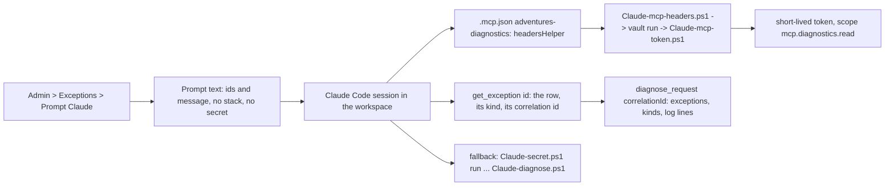

# Stage review: Prompt Claude through MCP (beta row 7), 2026-11-22

The Prompt Claude button on an exception row now hands Claude the evidence path through the app's own MCP server, so the review loop no longer needs the vault script typed by hand.

## What was built
- **A new read-only tool, `get_exception`** (`GET api/diagnostics/exception/{id}`, scope `mcp.diagnostics.read`, the same as the other three): one exception by the id of its row in the exception list, with the kind of failure and its correlation id. It works for a row with no correlation id (a failure at start-up), which is the gap the backlog named. A malformed id is a 400, an unknown one a 404; `IDiagnosticsReader.FindByEntryIdAsync` backs it.
- **The prompt:** names the MCP server and the steps (get_exception with the entry id, then diagnose_request with the correlation id, or exception_signatures and recent_exceptions when there is none). The vault script command stays as a fallback for a session without the MCP server. The text still carries only ids and the message, never the stack trace or a secret (specs pin it).
- **The registration:** `.mcp.json` in the workspace root gains `adventures-diagnostics` (`https://mcp.global-webnet.com/mcp`) with a `headersHelper`: `docs/Claude-mcp-headers.ps1` runs `docs/Claude-mcp-token.ps1` through the vault, so the client secret exists only in that one child process, and prints only the `Authorization` header.
- **Checked live (the point of "check the headersHelper first"):** the helper ran, produced a header object with one `Authorization: Bearer ...` entry, and that token was accepted by the deployed MCP server (`tools/list` answered with the three tools deployed today). The token was never shown. Not yet checked: that Claude Code itself accepts the `headersHelper` field and runs it at connect time; that needs a new Claude Code session in the workspace (steps in the ledger). If a version of Claude Code ignores the field, the fallback command in the prompt still works.
- **Tests:** reader (7 cases), controller (3), tool manifest guard (22 tools, each a real scope-guarded route), MCP server tool list (4 diagnostics tools), prompt specs (4). All suites pass.

## Not done
- `get_exception` is not live until the API and MCP servers are deployed with this branch (the live server lists three tools).
- The page cannot call Claude Code; it only builds the text, as decided.

## Test steps
See the ledger, A10.
