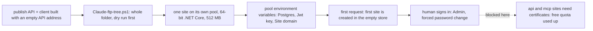

# Stage review: install proof run on a real second host (2026-11-22)

The first deployment of this app to a host that is not the project's own: a fresh SmarterASP site on its temporary address, an empty database, and the onboarding work (stages 1 to 4, single-site mode) meeting a real store for the first time. Hosting identifiers are placeholders here (`<temp-address>`, `<domain-name>`); the real ones are in the private workspace notes.

## What was proven
- A fresh install runs from a publish folder: the app starts against an empty PostgreSQL database, creates the identity tables and the first site on the first request, serves the client from the same site, answers anonymous requests correctly (admin routes 401, unknown paths not the page, deep links load, page policy with the inline-script hash).
- The human signed in as `Admin` with the default password and was held on the profile page until a new one was chosen; the admin menu then loaded (Tenants shows one tenant for the temp host, the Dashboard, Languages, Maintenance and the rest).
- Pools were created and sites moved with the hosting tools (three 64-bit .NET Core pools of 512, 512 and 256 MB), after the human freed RAM by shrinking the older pools (the tools cannot lower an existing pool's memory).

## Defects the real store found (all fixed, each with a test that fails without the fix)
1. **The first site's Admin person had no Id** (`Id is required`): the test fake assigned an Id itself and hid it. The fake now refuses a person without an Id like the real repository.
2. **Every request built the first-run services**, which need the sign-in store: CI has no Postgres connection string, so six host tests returned 500 (a developer machine has one in user-secrets, which hid it). The services are now built only when a host reaches no tenant, a failing first-run step is logged and never a 500, and the tenant-isolation host tests no longer reach a real sign-in store. A host test runs with the connection string removed.
3. **Machine client secrets named by position** (`M2MClients__Clients__3__Secret`) became named by purpose (`ClientSecret__ClaudeAuthor`), the old names still working; proven live on the real pools before the old variables were deleted.
4. **Tooling:** the new tree uploader mixed a short (8.3) and a long form of one folder name and shifted every remote path by a few characters (everything landed in a folder named `blish`); it now checks that every path lies under the local root before sending anything. `Claude-ftp.ps1 delete` mis-handled a one-segment path (a one-element array unrolled into a string). Uploads retry on a passive-mode hiccup.

## Lessons for anyone installing (also in the install guide)
- Read `logs/` on the site first (`stdout_*.log`, `startup-*.log`, `webapi-*.log`); an HTTP 500.30 has its reason there.
- The hosted PostgreSQL answers on port 6432 only; `SASL authentication failed` means the user name or password in the connection string was refused. Test the same login in the panel's pgAdmin, and use a simple password while installing.
- A pool is shown in the panel by an alias; the hosting API only knows numbers. Set the variables on the pool whose Websites list shows your site, then restart it (a failed in-process start stays failed).
- Replacing files on a running site: `app_offline.htm` first, then delete it.
- **DNS and certificates for your own domain:** check where the domain is really delegated (a domain can be delegated to a CDN while the host's CDN switch says OFF; the host's DNS screen then edits a zone nobody asks). The free certificate needs a direct A record (no proxy, no stray second address) and an HTTP 200 root. A CDN in its default mode encrypts to the visitor only and then speaks plain HTTP to your server, so the app's https redirect loops and passwords cross the internet in clear on that leg. The plan's free-certificate allowance can be used up; the service then only says it did not queue the request, and the panel's SSL page says "Free SSL quota used".

## What Claude can and cannot do on this host
See `docs/Claude-smarterasp-automation.md` in the workspace root (pools, sites, domains, DNS, SSL requests, files; not: existing pool memory, secret values, passwords, billing). Claude edited the CDN dashboard with Claude in Chrome after the human's explicit approval (three records set to DNS only, two stray A records deleted); it never touches values that are secrets.

## Not done, and why
- **The api and mcp sites** (the split layout and the optional MCP server) need a certificate on their own hostnames: the app redirects to https, a browser page cannot call a plain-http API, and a bearer token must never cross http. The free allowance is used up, so the options are a purchased certificate (the host sells a three-domain one for a year), or a free CDN origin certificate imported into the site with the CDN proxy on and its mode set to Full (strict), which also needs the app to trust the proxy's forwarded client address (a backlog item: the rate limits are per address and would be shared by every visitor).
- **Real memory use of the new pools** is not measured (the hosting tools report limits only).
- Not seen: the Admin screens beyond Tenants; the human's regression pass is ledger A16.

## Test steps
See the ledger, A16.
