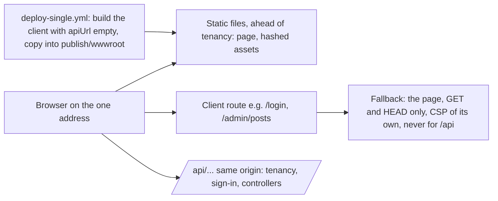

# Stage review: single-site mode, the API serves the client (2026-11-22)

Decided with the human the same day (`Claude-decision-2026-11-tenant-onboarding.md`, "Deployment mode"): one site is the install default, so a temporary address is the whole app and evaluation never needs a domain.

## What was built
- **`ClientSite`** (host): when the web root holds an `index.html` (and `Hosting:ServeClient` is not `false`) the host serves the client. Without a build nothing changes: the host is the API alone, as before. The root is the page itself (still HTTP 200, which SmarterASP's certificate request needs), so the JSON banner is only mapped when no client is present (routing had already chosen it for the root, and static files only answer requests that have no endpoint).
- **A policy of its own for the page.** The API's default is `default-src 'none'` and would blank the app. The page's policy is built from the page itself at start-up: scripts only from this site plus the **SHA-256 hash of each inline script** the build emitted (the build has one), no `unsafe-inline` for scripts, no `unsafe-eval`, requests only to this site, no framing, no plugins; styles may be inline (the component library needs it) and may come from this site and Google Fonts; fonts from Google Fonts; images from this site, `data:`, `blob:` and https. The API itself keeps `default-src 'none'` (tested).
- **Cache rules:** the page is `no-cache`; files with a build hash in the name (`main-XXXX.js`, chunks, styles, fonts) are cached for a year as immutable; anything else is `no-cache`.
- **Client routes** (no file extension, not under `/api`) answer the page for GET and HEAD; an unknown `/api` route, a missing file (`/missing.js`) and any other method are never the page (a missing file is a plain 404). A path that tries to leave the web root serves nothing.
- **The workflow `deploy-single.yml`** (repository variable `DEPLOY_MODE=single`): publish the API, build the client with an empty `apiUrl`, copy it into `publish/wwwroot`, deploy one FTP site, smoke-test `/api/health` and the page. The two split workflows now skip when `DEPLOY_MODE=single`; unset (our own layout) nothing changes.
- **Tests:** 18 host tests with a real pipeline and a temporary web root (root is the page, the policy and its hash, hashed assets, four client routes, three API paths, three missing files, a post, path escape, the API's own policy, no-client behaviour, the off switch). All 46 host tests, the API and MCP suites pass.

## Verified for real
The client was built with an empty `apiUrl`, served by the API from a scratch web root, and opened in the browser pane: the page rendered with working icons and fonts, took its site title from the same-origin API, a deep link to `/login` worked, and the console showed no policy violations. (The API ran with the Legacy developer settings, not against a database.)

## Not verified
- **`deploy-single.yml` has never run** (no Actions run from here, and no YAML parser was available to lint it); the commands are the ones the split workflows already use plus the client build. Treat the first run as a test.
- **SmarterASP behaviour with a temporary address** (https availability, the IIS handler order for static files) is untested; the in-process ASP.NET Core module serves everything, which is the expected path.
- The setup page for an unknown host (stage 3) is the next step: it is part of the client, so it is now reachable from the same host.

## Test steps
See the ledger, A13.
