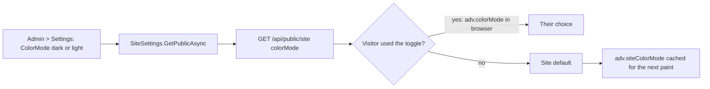

# Stage review: site colour mode (beta row 14), 2026-11-22

An administrator picks Dark or Light for the whole site; a visitor's own header toggle still wins once used and is remembered in their browser.

## What was built
- **Foundation:** `ColorMode` is a known setting (created for a tenant that lacks it, default `dark`, like `CommentsEnabled`); `PublicSiteSettings.ColorMode` is `light` only when the setting says light (any other value, or none, is dark, so a typo never changes the look).
- **Client:** `SiteSettings.colorMode`; the app applies the site default to a visitor with no stored choice, the toggle stores `adv.colorMode`, the last site default is cached in `adv.siteColorMode` so a light site does not start dark on a repeat visit. Browser storage that is missing or refused is tolerated.
- **Tests (written with the change, all passing):** Foundation `SiteSettingsTests` (6 colour mode cases, counts now six settings), client `App colour mode` (5 specs). Full Foundation suite, app API suite, all client projects and `build:libs` pass; the production build completes (initial bundle 964.92 kB, over the 600 kB warning budget as before; no error).

## Not verified
- Not seen in a browser. The very first visit to a light site still shows dark until the settings answer arrives (the cache covers every later visit).
- The Settings screen shows ColorMode as a free-text value (`dark` or `light`); a drop-down needs a typed setting kind, so it is a later refinement.

## Test steps
1. Admin > Settings: set ColorMode to `light`, save, reload the public site in a private window: light.
2. Use the header toggle: dark; reload: stays dark even after changing the setting.
