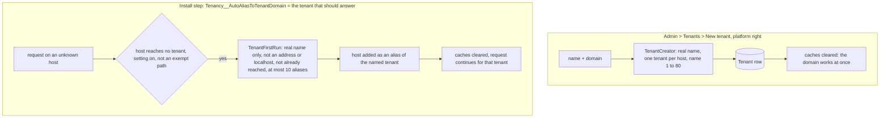

# Stage review: T4b, create a tenant from one place and the temporary address on a fresh install (beta row 5), 2026-11-22

The rest of T4 that can be decided and tested now: a platform administrator creates a tenant on a domain with a name and the domain, and an operator can let a fresh install's temporary address reach a named tenant before anyone has signed in. Sharing another domain's data is deliberately not built (reason below).

## What was built
- **`ITenantCreator` and `POST api/tenant`** (platform right): a name (1 to 80 characters, no control characters) and a domain. The domain must be a real name (not an address, not `localhost`, with a dot) that no other tenant reaches, neither as its domain or alias nor as a name above or under one, so nobody can claim a host that is not theirs. The new tenant has no data yet; its site settings, plug-in state and widgets create themselves on first use. The Admin > Tenants screen has a New tenant form (name, domain, Create) that shows the server's reason when it refuses. Adding the people who run it is the Users screen's job; a platform administrator can already work in every tenant through the switcher.
- **The first-run alias (`ITenantFirstRun`, `Tenancy:AutoAliasToTenantDomain`):** when this one setting names a tenant by its domain, an unknown host (not an exempt path) is added as an alias of that tenant, once, the caches are cleared and the request carries on for that tenant. It never aliases anything that is not a real name, never a host some tenant already reaches, and stops at 10 aliases on the tenant. Default empty = off, so nothing changes for a running site.
- **The CORS side needs nothing new:** T4a already allows exactly the origins of registered domains and aliases, so the aliased temporary address can call the API (its preflight is the same data).
- **Tests:** creation (rules, duplicates, side by side), first run (alias, decline, junk, cap), middleware (off, on, known host, declined, exempt path, cache cleared), controller (platform right, answer, 409), client (3). Foundation, API and host suites and all client projects pass; the production build passes.

## Decisions and why
- **Explicit and operator-set, not automatic by default.** The backlog asked for no prompts; the safe reading of "limited" (its own design note) is an explicit setting. One host-panel setting at install, then cleared, is the whole step (see the install guide). If you would rather have it on whenever the store holds exactly one tenant, that is a one-line change, but it would let any bound host name become an alias of that tenant on a store you did not set up for it.
- **Tenant data sharing ("reuse another domain's configuration/data") is not built.** It needs a model for read-only versus write-through, the source tenant's consent, and rights checked on both sides, and it changes how every repository resolves its graph. It stays in the backlog; building it half-way would be a data-leak risk, not a feature.

## Not done
- No first administrator or role assignment is created for a new tenant (the platform administrator can switch into it; adding people is on Users).
- A domain-ownership proof (DNS TXT) is not built; the trust rule is the host's own site bindings, as decided for beta.
- Not seen in a browser.

## Test steps
See the ledger, A11.
