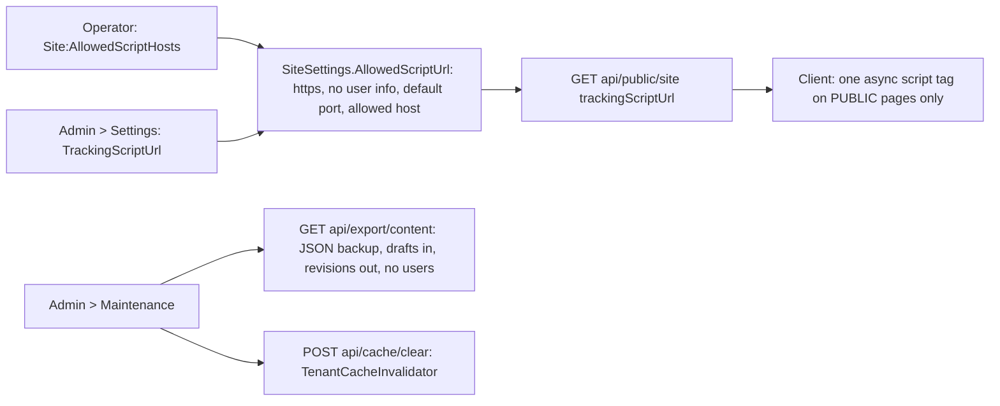

# Stage review: tracking script, content export and clear cache (beta row 12, parity stage 4), 2026-11-22

BlogEngine's Controls "Tracking Script" and Advanced "Export" and "Clear blog cache", each cut to what is safe and real here.

## What was built
- **Tracking script, not free-form code (decision, with the reason):** BlogEngine lets an editor paste any HTML into every page head. Here a script runs with the full power of the page and can read an administrator's sign-in from browser storage, so a pasted script would let anyone with the settings right take over every other administrator. Instead: the setting `TrackingScriptUrl` is ONE https address, accepted only when its host is in the operator's list (`Site:AllowedScriptHosts`, empty by default, so the feature is off until the operator vouches for a host). No user info, no odd port, no quote or angle bracket, no look-alike host (`analytics.example.org.evil.net`, `allowed@evil.net`) gets through. The client adds one `async` script tag on public pages only, never in the admin area, and removes it when the setting is cleared. Inline snippets (a Google Analytics config) are not supported; that is a deliberate limit, not an omission.
- **Export:** `GET api/export/content` (site-settings right) downloads `content-export-<date>.json`: every post and page with text, format, dates, categories, tags and the page tree (parent, sort order, flags); drafts included, proposed revisions left out, no user ids, passwords or secrets. It is a backup you can read, not yet an import (BlogML import is the after-beta migration path).
- **Clear cache:** `POST api/cache/clear` clears the tenant and CORS caches (the only server-side caches). Honest scope: they expire within a minute anyway; the button makes a change visible at once.
- **Admin > System > Maintenance** holds both buttons.
- **Tests:** tracking address (16 cases) and export (4) in Foundation, 4 controller tests, 3 client specs for the script and 3 for the screen; every suite and both builds pass.

## Not done
- Inline tracking code, an import, BlogML, and Atom/feed options stay after beta. Not seen in a browser; no real analytics host was loaded.

## Test steps
1. Without any configuration, set `TrackingScriptUrl` to an https address and reload the public site: no script tag appears (no allowed host).
2. Set `Site__AllowedScriptHosts__0` (host secret or user-secret) to the analytics host and restart; the same setting now adds one script tag on public pages and none under /admin. A look-alike host or an http address adds nothing.
3. Admin > Maintenance > Download a backup: a JSON file arrives with your posts, pages and drafts and no user names or passwords.
4. Clear the cache: a confirmation; the next request works normally.
