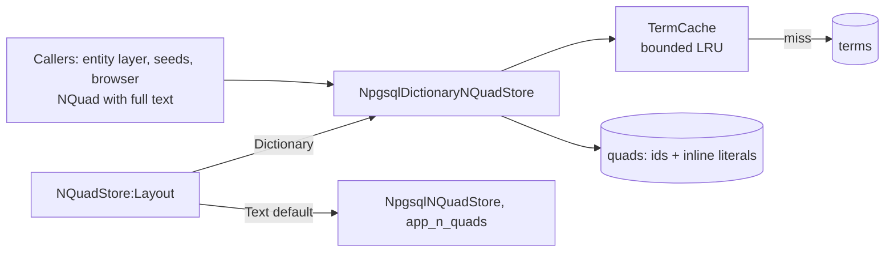

# Stage review: the hybrid-dictionary quad store (beta row 9, implementation)

Date: 2026-11-23. Branch `claude-session-2026-12-11` in the Foundation and the app repo, committed, not pushed or deployed. **Not switched on anywhere:** the default layout is still today's text table; the new one is chosen by a setting and keeps its data in its own tables. Decision it implements: `docs/Claude-decision-2026-11-quad-storage.md` (approved by the human, "Yes, build it").

## What was built

- **`NpgsqlDictionaryNQuadStore`** (`Adventures.Data.NQuad.Postgres`), an `INQuadStore` with the same contract as the text table: subject, predicate, graph and an object that is an IRI become rows of `{prefix}_terms`; the quad row `{prefix}_quads` holds integers (`g` nullable for the default graph) and keeps every other object inline as text (`lit`); a CHECK allows exactly one of the two. The quad id stays a GUID, so the by-id update and delete above the store do not change. Indexes as benchmarked: `(s, p, g)`, `(p, o, g, s)` for IRI objects, `(p, left(lit, 255), g)` for literals, `(g, p, s)`.
- **`IsIri`** decides where an object goes from its text alone (`http://`, `https://`, `urn:`, within 2,000 UTF-8 bytes), the same on write and on query, so what is written is always found; an address-looking literal still comes back exactly as written.
- **`TermCache`**, a bounded least-recently-used cache (default 50,000 terms), so a query returns integers and the store expands them in memory; the dictionary is append-only, so a cached id never goes stale, and the cache learns new terms only after the writing transaction commits (a rolled-back batch leaves no stale id).
- **`NQuadStoreFactory`** and the setting `NQuadStore:Layout` (`Text` by default, or `Dictionary`; `NQuadStore:Prefix` names the tables, default `app_dq`), wired into the API and the NQuad browser. A typo stops the start naming the setting. The two layouts never read each other's tables.
- **`Claude-quad-bench scratch`**: reports and drops a scratch dictionary store left by a test run (prefix must start with `scratch_`).

## Verified

- **The shared store contract (16 behaviours) passes against the new store on the real local PostgreSQL**, plus 23 test cases of what is specific to it: where objects go and how they come back, the dictionary only growing, unknown terms matching nothing and creating nothing, over-long terms refused, a failed batch leaving no stale cache id, purge keeping the dictionary, a second instance and a three-term cache reading the same data, the cache bound, the prefix validation; the factory has 9 cases. Every Foundation suite (22) and every app suite pass.
- **The real API ran on the dictionary layout** (scratch tables in the local database): it applied the real seeds (1,545 quads, 587 terms; 564 IRI objects, 981 literals) and answered runtime, menu, posts, tags and health with 200, the home page with 204 and the admin routes with 401 as they should. The scratch tables were dropped afterwards.

## Not verified / open

- Not run behind a browser; not run with the Admin sign-in (the local Admin password differs) or with a write through the API. The store contract covers writes.
- The quad id is a GUID (the layer above needs it), so the quad table is about 3% larger than the benchmark's bigint id; the decision's numbers stand.
- No concurrency stress test of two writers adding the same new term (the unique index and `ON CONFLICT DO NOTHING` are the design; a stress test is worth adding before the cutover).
- **Not done yet, needed for the cutover (row 11):** `Claude-nquad-tool` (export, restore, relabel, grant) and the human's scripts still speak SQL to the text table only; the dictionary layout needs a bulk copy path from the text table; the schema site (row 10) reads through the store interface and needs no change.
